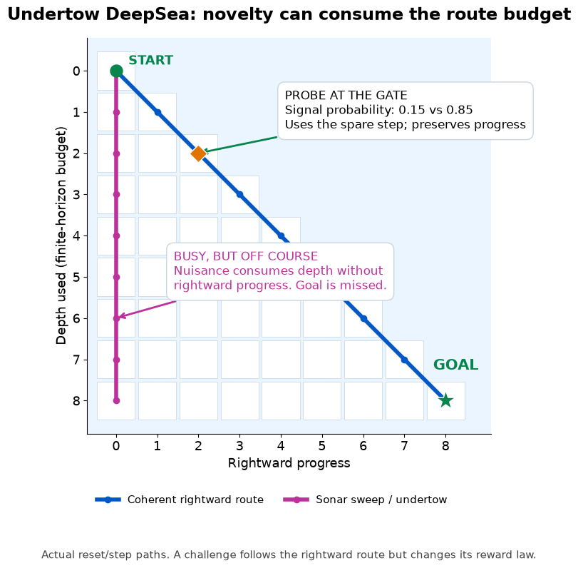
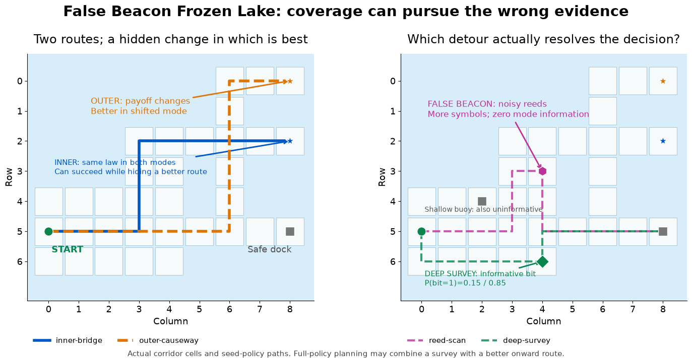

# Confounder-Eliminating Actor-Critic

Can an RL agent purchase the specific trajectory evidence needed to rule out
models that change the optimal policy, instead of paying for irrelevant novelty?

This branch contains **Undertow DeepSea** and **False Beacon Frozen Lake**, a
maintained finite-model CEAC implementation, source-backed primitive controls, and an
executed visual walkthrough.

**Start with [the notebook](notebooks/Undertow_FalseBeacon.ipynb).** Its saved
outputs render on GitHub. It explains the route geometry, the confounding
mechanism, nuisance versus useful evidence, and what the completed runs show.




## Install and run the notebook

From this repository's root, with Python 3.10 or newer:

```bash
python3 -m venv .venv
source .venv/bin/activate
python -m pip install -e '.[notebook]'
python -m ipykernel install --sys-prefix --name ceac-undertow --display-name "Python (CEAC)"
python -m jupyter lab notebooks/Undertow_FalseBeacon.ipynb
```

Choose **Python (CEAC)**. In VS Code, select this repository's `.venv/bin/python`.
The notebook dependencies include `ipykernel`; installing inside a different
Python environment does not repair the selected kernel. Windows activation is
`.venv\Scripts\Activate.ps1` in PowerShell.

The notebook runs offline after installation and launches no training. A compact,
hash-verified evidence export is included; raw local training caches are not
required. It verifies 336 base runs and 48 additional prior-support runs, retaining 192
CEAC/oracle/IDS runs after excluding the retired custom controls. There are three seeds per plotted condition.

For headless verification with the active interpreter:

```bash
python scripts/verify_notebook.py
python -m unittest discover -s tests/ceac -v
python -m unittest discover -s tests/walkthrough -v
```

## What these benchmarks establish

- **Undertow:** nuisance moves consume the navigation horizon without progress.
  Their symbols are diverse but have zero likelihood information about the task.
- **False Beacon:** reeds and shallow surveys can attract coverage while the
  inner route hides a profitable outer alternative. A deep survey reveals the mode.
- The retained CEAC and full-support IDS curves are stable across nuisance
  alphabets. This is not yet a physical undertow/false-beacon strength sweep.
- Custom policy-bank UCB, model optimism, uniform-bank sampling and the
  finite-policy OIR surrogate are retired. Their curves do not establish
  failures of published coverage/optimism algorithms.
- Zero-prior IDS is an explicitly misspecified support treatment. It does not
  refute full-support IDS or show that CEAC discovers undeclared models.

The plotted CEAC is a **single episode-loop, exact-model specialization**. The
realized mode is unknown to CEAC; candidate laws, evaluation and policy separation
are available. Certified deployment requires a reward-optimal response for every
currently plausible model. The offline Graves–Lai oracle additionally knows the
realized mode from the outset. These runs do not isolate learned-critic causality:
34/48 CEAC runs made zero actor/critic updates and no learned actor proposal was
admitted. See the [implementation ledger](audits/ceac_v90_corrections_20261110.md)
and [benchmark ledger](audits/ceac_undertow_design_20261110.md).

## Source-backed comparators

`idac` ports the original tabular softmax/two-critic update from the supplied
`inforatio-main.zip` and Sahire's pinned repository. `ucb_q` implements Jin et al.
(2018), Algorithm 1, at primitive state/action level. `pomd` implements optimistic softmax mirror descent from Shani et al. (2020),
Algorithm 2. None uses the old policy bank. See the [source and adaptation ledger](docs/comparator_provenance.md) for
exact equations, parity checks, reward normalization and reset semantics.
The 48-cell [integration audit](audits/comparator_validation.json) verifies all
three replacements. Historical notebook plots remain distinct from those short
smoke results; they are not relabeled or pooled across source versions.

## Run new experiments

```bash
python -m ceac.run --output runs/my_smoke --benchmarks weak_signal_m4 \
  --environments deepsea frozenlake --methods ceac oracle ids idac ucb_q pomd \
  --modes 0 1 --seeds 0 --episodes 32 --workers 1
python -m ceac.report --input runs/my_smoke
```

This short run checks integration, not convergence. Always choose a new output
folder. See [ceac/README.md](ceac/README.md) for the complete multi-seed slate,
cache identity, scientific assumptions and report controls. Core dependencies are
NumPy and SciPy; `pip install -e '.[report]'` adds plotting without Jupyter.
PDF report export additionally requires system `pandoc` and `pdflatex`.

## Layout

| Path | Responsibility |
|---|---|
| `ceac/` | Problems, learners, runner, immutable evidence and report rendering |
| `ceac_walkthrough/` | Explanatory maps and portable evidence loader |
| `notebooks/` | One executed notebook, compact evidence and figure assets |
| `scripts/` | Evidence export and notebook verification |
| `tests/` | Algorithm, statistical reporting and walkthrough checks |
| `audits/` | Mathematical scope and deviation ledgers |
| `runs/` | Local raw studies, excluded from Git |
| `legacy/upstream/` | Original standalone DeepSea script, retained unchanged |

The original `inforatio` package remains in a local archive; the new IDAC port
has a small pinned source fixture for numerical parity tests. Historical study
paths and archived runtimes are preserved. Details:
[repository layout](docs/repository_layout.md) and
[publication validation](docs/validation.md).
