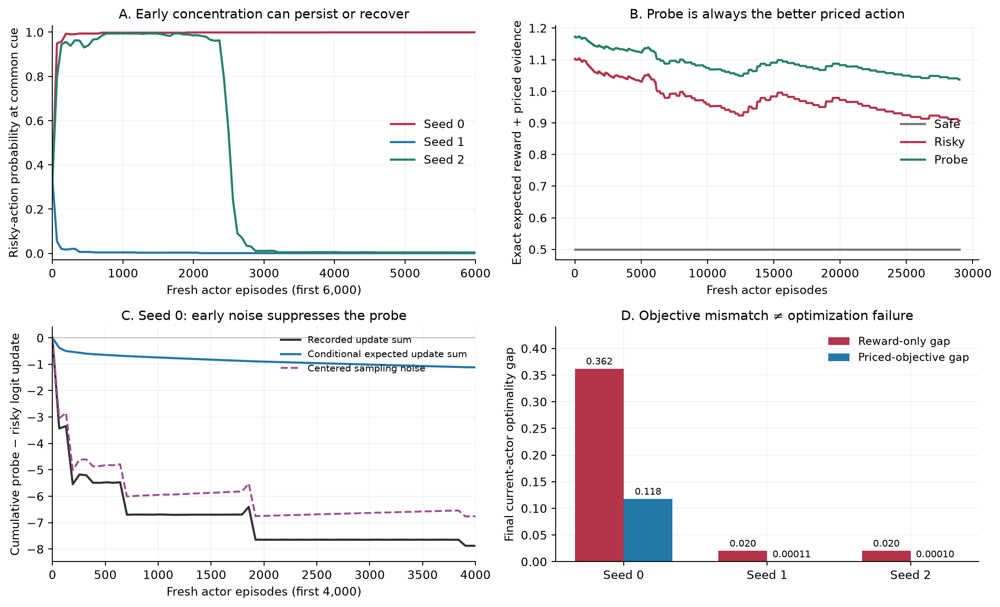

# Why did the CEAC actor fail?

**The large task-0 failures are not caused by a missing or delayed intrinsic reward.** The observed mechanism is early stochastic concentration, weak correction under a nearly deterministic softmax policy, and a separate persistent evidence premium that makes even a well-optimized actor prefer probing to pure reward exploitation.

This is a read-only audit of all **30 CEAC prior-shift cells / 870,000 fresh actor episodes**. Every saved actor-policy identity is reconstructed. No training, actor-only ablation, altered trajectory or post-test tuning is used. The raw studies and numerical kernels are unchanged.



A shows all three seeds at the cue state visited with probability 0.9; B and C diagnose seed 0. C's conditional expectations are evaluated along the *recorded stochastic policy history*, not the trajectory of a hypothetical deterministic-gradient learner. D compares the final current actor; the published endpoint averages the last 256 behavior episodes, including diagnostics, and is a different statistic.

## 1. Evidence is dense; corrective action samples become rare

The only action choice is terminal, immediately after a forced cue. Risky and probe outcomes each supply a nonzero task likelihood ratio. The safe action supplies zero. There is no long-horizon credit-assignment problem at this decision.

For task 0 / d=0 / seed 0, **99.897% of actor decisions** have nonzero priced evidence. This is already 96.5% in the first 512 actor episodes and 100% in the final 4,096 episode window. Mean absolute terminal evidence over the run is 1.072.

Yet the final common-cue policy is:

| Action | Probability | Expected external reward | Expected priced evidence | Combined value |
|---|---:|---:|---:|---:|
| Safe | 0.00018451 | 0.50 | 0.000000 | 0.500000 |
| Risky | 0.99948086 | 0.10 | 0.806511 | 0.906511 |
| Probe | 0.00033463 | 0.48 | 0.557113 | 1.037113 |

The probe is clearly better under the current objective, but is sampled with probability only 0.000335. In the final 4,096 episode window, the actor visited this cue state **3,667 times and sampled the probe 0 times**. There is abundant intrinsic signal from the action it already favors; observations of the corrective action have become rare.

## 2. The current evidence price never makes risky the best action

Let w be the sum of active task-changing evidence prices. Cue evidence is action-independent and can be omitted from the terminal action comparison. The exact task-0 action values are:

```
Q_safe(w)  = 0.50
Q_risky(w) = 0.10 + 1.757780 w
Q_probe(w) = 0.48 + 1.214221 w
```

The coefficients are KL divergences: `KL(Bernoulli(0.1) || Bernoulli(0.9))` and `KL(Bernoulli(0.15) || Bernoulli(0.85))`. Probe beats safe when w > 0.016471, and probe beats risky when w < 0.699096.

The failed run's price stays between **0.458824 and 0.571737**. Probe is therefore the unique optimal terminal action throughout the actor run; its advantage over risky ranges from 0.069227 to 0.130602. There is no probe-to-risky target switch to explain the collapse. The same ordering holds in all 15 task-0 cells.

## 3. Early sampling noise, then softmax saturation

The evidence reward is signed and noisy, even though it is dense. At the first actor price, the expected combined returns are 1.103 for risky and 1.173 for probe, but their single-observation standard deviations are 0.452 and 0.707. The mean advantage is about 0.07 against much larger outcome noise. A constant actor step of 0.4 can therefore create large early preference changes.

By fresh actor update **155**, seed 0 assigns risky probability 0.992769 at the common cue, while probe remains better by 0.070927. The probe-minus-risky logit change at that point is -5.5146; its conditional expected-update sum along the saved history is -0.5142. The difference, **-5.0004**, is the accumulated centered sampling-noise term. This is an exact decomposition, not a significance test or a counterfactual performance claim.

For this terminal decision, an arbitrary frozen state baseline b cancels from the conditional mean actor update. At temperature 1:

```
E[delta_theta_a | state, history]
    = alpha * pi(a) * (Q_beta(a) - sum_b pi(b) Q_beta(b)).
```

Consequently, two distinct effects occur. A rare good action has a tiny update because of the factor pi(a). Also, when both risky and probe beat safe, suppressing safe can initially increase the more-probable risky action's logit faster than the probe's—even though probe has the highest Q. The negative conditional-drift segment in panel C is compatible with an unbiased ascent direction for the *whole* objective. A higher Q does not guarantee monotonically improving pairwise softmax odds.

At the failed endpoint, probe's expected logit increment is only **0.00001749 per common-state actor visit**. The expected probe-minus-risky logit increment is 0.00000497, against conditional per-step standard deviation 0.008863. The conditional priced-objective gap is still 0.130634. These are local moments at the recorded endpoint, not an extrapolated recovery-time prediction.

At fixed prices, the objective here is linear in each state's action probabilities. It has no suboptimal interior local maximum: the finite-budget problem is a near-boundary softmax plateau with rare corrective samples. Seed 2 also temporarily exceeds 99% risky probability, then recovers; the plateau is not absorbing or proof of inevitable failure.

## 4. Critic error affects variance here, not mean direction

The terminal reward/evidence critics act only as state baselines. The preceding cue action is forced and has zero policy score. Thus errors in these critic values cannot systematically bias the conditional actor gradient in this particular junction. This conclusion need not extend to multi-step decisions with bootstrapped action-dependent successors.

The failed run's first-512-actor reward/evidence critic RMSEs against exact current-policy values are 0.092/0.209. Both critics remain finite. Critic errors and changing prices can alter variance; this audit does not identify their separate causal contribution to collapse. The actor step is 0.4, the reward-critic step 0.12. With a single price w, the evidence-value update has effective step `0.12*w^2` (roughly 0.025–0.039 here), so the configuration does not impose a faster-critic/slower-actor regime. That is a justified parameter-sensitivity hypothesis, not a demonstrated fix.

## 5. The small residual is a different problem: conservative replay pricing

Successful task-0 actors converge close to the probe's priced-objective optimum. The probe pays 0.48 while safe pays 0.50, so roughly 0.02 external-reward loss is expected even with an accurate optimizer under these prices. Calling that entire residual an actor-learning failure would be incorrect.

For seed 0, the final replay-derived price is **0.458824**, versus **0.016471** from an evaluator-only known-kernel Graves–Lai solve. This is a reference calculation, not a replacement behavior policy. The final bank policies have only **[484, 484, 484, 484, 484] compatible episodes each**, despite 29,000 fresh actor episodes. Every changing actor policy has its own label; its data cannot simply be pooled into another frozen policy's confidence stratum.

For the probe policy, the empirical return is 0.48 but its lower confidence bound is about 0.321. Against the active row, empirical trajectory evidence is about 1.303 but its lower bound is about 0.390. The conservative cost/evidence ratio is consequently `(0.5 - 0.321)/0.390 ≈ 0.459`. This directly explains the elevated dual price. More refreshes without more compatible evidence do not automatically shrink those bounds.

## 6. All held-out cells remain in the diagnosis

There are **3 cells with a final priced-objective gap above 0.01**; the other 27 have gaps at most 0.000263. The threshold only labels this audit table; it excludes no run. The large failures are task 0 / seed 0 at d=0, 0.75 and 1.

| Dose | Task | Seed | Final actor reward gap | Final actor priced-objective gap | Original late behavior gap |
|---|---:|---:|---:|---:|---:|
| 0 | 0 | 0 | 0.361966 | 0.117649 | 0.358108 |
| 0 | 0 | 1 | 0.020129 | 0.000107 | 0.022939 |
| 0 | 0 | 2 | 0.020182 | 0.000097 | 0.022992 |
| 0 | 1 | 0 | 0.000043 | 0.000065 | 0.004808 |
| 0 | 1 | 1 | 0.000121 | 0.000172 | 0.004884 |
| 0 | 1 | 2 | 0.000041 | 0.000054 | 0.004806 |
| 0.25 | 0 | 0 | 0.020375 | 0.000207 | 0.023194 |
| 0.25 | 0 | 1 | 0.020115 | 0.000118 | 0.022925 |
| 0.25 | 0 | 2 | 0.020087 | 0.000055 | 0.022898 |
| 0.25 | 1 | 0 | 0.000061 | 0.000091 | 0.004825 |
| 0.25 | 1 | 1 | 0.000133 | 0.000189 | 0.004896 |
| 0.25 | 1 | 2 | 0.000060 | 0.000082 | 0.004825 |
| 0.5 | 0 | 0 | 0.020491 | 0.000263 | 0.023294 |
| 0.5 | 0 | 1 | 0.020157 | 0.000133 | 0.022966 |
| 0.5 | 0 | 2 | 0.020100 | 0.000066 | 0.022911 |
| 0.5 | 1 | 0 | 0.000067 | 0.000101 | 0.004831 |
| 0.5 | 1 | 1 | 0.000142 | 0.000203 | 0.004905 |
| 0.5 | 1 | 2 | 0.000051 | 0.000069 | 0.004816 |
| 0.75 | 0 | 0 | 0.286057 | 0.089294 | 0.283674 |
| 0.75 | 0 | 1 | 0.020118 | 0.000118 | 0.022928 |
| 0.75 | 0 | 2 | 0.020167 | 0.000079 | 0.022976 |
| 0.75 | 1 | 0 | 0.000053 | 0.000083 | 0.004818 |
| 0.75 | 1 | 1 | 0.000144 | 0.000201 | 0.004907 |
| 0.75 | 1 | 2 | 0.000067 | 0.000093 | 0.004832 |
| 1 | 0 | 0 | 0.361993 | 0.111016 | 0.358127 |
| 1 | 0 | 1 | 0.020065 | 0.000074 | 0.022876 |
| 1 | 0 | 2 | 0.020129 | 0.000067 | 0.022939 |
| 1 | 1 | 0 | 0.000061 | 0.000092 | 0.004825 |
| 1 | 1 | 1 | 0.000127 | 0.000180 | 0.004890 |
| 1 | 1 | 2 | 0.000074 | 0.000097 | 0.004838 |

## Consequences for the next experiment

1. Test actor/critic step-size separation using independent calibration seeds, preserving both critics and evidence-priced replay. Measure early action concentration, conditional gradient noise, and final priced-objective gap. This targets the large failures.
2. Separately test certified replay precision: compatible sample allocation or a tighter valid confidence construction. Measure price inflation and pure-reward versus priced-objective gaps. This targets the small persistent probing cost.
3. Keep original held-out results intact, fix the revised configuration before a new evaluation, and retain both tasks. A stronger generic intrinsic bonus is not supported by this diagnosis; it can further favor persistent information gathering. Any entropy floor, projection, or altered behavior schedule would be an explicit algorithmic change needing its own specification.

The existing evidence supports these mechanisms but does not establish which proposed change improves performance. No ablation or repair run has been launched.

Reproduce from the repository root with `python scripts/diagnose_actor_failures.py` followed by `python scripts/render_actor_diagnosis.py`. The first script verifies numerical sources, raw hashes and every actor-policy identity. The second verifies the diagnostic export before rendering. Conditional-gradient means were checked against finite differences, and variances against exhaustive action/outcome enumeration.
