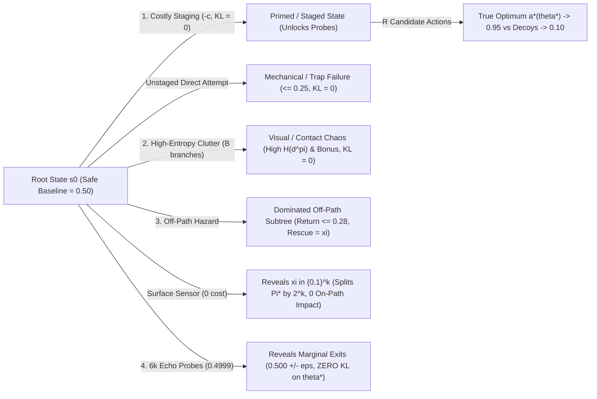

# Next-Stage Benchmark Plan: Pathological Atari & Multi-Step Dexterous Manipulation

This collaborator design document specifies the next experimental phase for **Confounder-Eliminating Actor-Critic (CEAC)**: scaling the exact **four-ingredient confounder anatomy** validated in our tabular/DAG suites (`undertow_pathdep`, `false_beacon_pathdep`, `signalling_rewiring`, and `canalized_gi`) to **(I) Atari / Arcade environments** and **(II) Multi-Step Dexterous Manipulation**.

---

## 1. Universal Four-Ingredient Confounder Skeleton

Across our completed finite-horizon suites ([Undertow & False Beacon Diagnostics](../notebooks/Undertow_FalseBeacon_Diagnostics.ipynb) and [Pathological Search Suite](../notebooks/Pathological_Search_Suite.ipynb)), we proved both mathematically and empirically that **four simultaneous structural ingredients** are required to separate CEAC (`ceac_ranked`) from **all** major exploration paradigms—including Russo–Van Roy Optimal-Action IDS:

| Ingredient | Formal Role | Methods Broken | Why CEAC (`ceac_ranked`) Survives |
|---|---|---|---|
| **1. Zero-KL Multi-Step Staging Gate** ($s_0 \xrightarrow{-c,\;\text{KL}=0} s_{\text{primed}}$) | Reaching informative probes or the $+0.95$ optimum requires a physical preparation sequence that incurs step cost $-c < 0$ and emits `0` immediate task bits; unstaged attempts fail ($\le 0.25$). | Myopic 1-step information-ratio heuristics & $\epsilon$-greedy RL. | Backward Bellman evidence critic $Q_I(s, a; \beta_t)$ propagates future likelihood-ratio value across zero-KL preparation steps. |
| **2. High-Entropy Nuisance Breadth ($B$)** | Exogenous or action-triggered visual/contact chaos with zero likelihood ratio across task-optimal policies. | **IDAC / MaxEnt RL** ($H(d^\pi)$), **UCB / POMD**, **RND / ICM / World-Model Disagreement**. | Dual prices $\beta_t$ weight transitions strictly by log-likelihood ratios between undefeated optima; zero-KL transitions receive $\beta = 0$ and Held-Out Evidence Critic RMSE $\to 0$. |
| **3. Off-Path $\xi$-Contingent Subtrees ($(3^k - 1)$ states)** | Strictly dominated off-path states ($V^\star(s_{\text{off}}) \le 0.28 < 0.50$, never optimal to enter from $s_0$) whose local damage-control actions depend on latent nuisance bits $\xi \in \{0, 1\}^k$ observable cheaply near $s_0$. | **Full-Model Bayesian IDS** ($I(\theta, \xi; Z)$) and **Russo–Van Roy Policy-Tree IDS** ($I(\Pi^\star; Z)$), because Bellman optimality defines $\Pi^\star(\theta, \xi)$ at *every* state, splitting $\Pi^\star$ by $2^k$. | CEAC's replay master prices separation only across **undefeated root-reachable policy returns**, ignoring off-path counterfactual policy splits. |
| **4. Echoed Marginal Sub-Optima ($6k$ channels)** | Cheap inspection actions (`0.4999`) that carry positive mutual information about peripheral micro-suboptima ($0.500 \pm \epsilon$, $\epsilon \approx 10^{-3}$) while providing **zero KL** between the safe baseline and the gated $+0.95$ responder $\theta^\star$. | **Quotiented On-Path Optimal-Action IDS** ($I(C_{\text{on-path}}^\star; Z)$), whose scalar entropy $H(C_{\text{on-path}}^\star)$ treats a $10^{-3}$-gap bit on par with a $0.45$-gap bit. | Vector-valued pairwise Graves–Lai constraints weight each undefeated pair $(m, j)$ proportionally to its return gap; greedy disagreement column admission (`ceac_ranked`) admits `~2` active columns instead of sweeping peripheral echoes. |

---

## 2. Pathological Atari / Arcade Suite

> [!TIP]
> **Two-Tier Arcade Execution (`JaxAtari / MinAtar` $\to$ `ALE Pixel Wrapper`)**: Implementing each game first as a vectorized JAX/NumPy state+sprite kernel (`~10^4` steps/s) lets us run **exact Bayesian IDS controls** ($I(\Pi^\star; Z)$ and $I(C_{\text{on-path}}^\star; Z)$) and **exact Held-Out Reward & Evidence Critic Bellman RMSE audits** alongside CNN/MLP neural critics before scaling to `84×84×4` ALE pixel stacks.

### 2.1 *Montezuma's Switchyard* (Multi-Room Key Staging + Arcade Confounders)
- **Safe Baseline (`+0.50`)**: Exiting directly through the upper courtyard archway.
- **Ingredient 1 — Zero-KL Staging Gate**: Panama Joe must climb down the central ladder, cross a reversing conveyor, and collect the **Insulated Key** ($-0.015$ step/fuel cost, `0` bits about which vault holds the jewel) to enter `lower_vault_armed`. Touching any of the $R = 8$ **Vault Relics** bare-handed triggers an electric shock trap (`+0.20`, `0` KL); unlocking relic $r$ with the key pays `+0.95` if $r = \theta^\star$ and `+0.10` otherwise.
- **Ingredient 2 — Nuisance Breadth ($B$, Breaks IDAC & RND/Curiosity)**: Striking a courtyard **Arcade Gong** spawns $B$ bouncing multi-color skulls and flickering mosaic tiles in a side gallery—maximizing pixel/RAM state novelty and dynamics-prediction error without unlocking any room.
- **Ingredient 3 — Off-Path $\xi$-Subtrees (Breaks Policy-Tree IDS $I(\Pi^\star; Z)$)**: Falling into any of $(3^k - 1)$ **Spider Pits** caps episode return at `+0.26 < +0.50`, but escaping the pit (`+0.26` vs. `0.00`) requires rolling left or right according to each spider's latent patrol parity $\xi_b \in \{0, 1\}$, observable for free by peering over the top balcony.
- **Ingredient 4 — Echoed Marginal Exits (Breaks Quotiented IDS $I(C_{\text{on-path}}^\star; Z)$)**: $6k$ **Courtyard Wall Frescoes** near spawn reveal whether peripheral coin alcoves pay `0.5004` vs. `0.4996` (`0` KL on the lower vault jewel $\theta^\star$).

### 2.2 *Seaquest Thermocline* (Arcade Counterpart to `undertow_pathdep`)
- **Safe Baseline (`+0.50`)**: Surfacing at the harbor buoy with standard cargo.
- **Ingredient 1 — Zero-KL Staging Gate**: Engaging **Ballast Trim + Oxygen Top-Up** ($-0.015$, `0` KL) is required to dive past a mid-depth **Thermocline Shear Current** into the abyssal trench containing $R = 8$ **Submerged Diver Beacons** (`+0.94` on $\theta^\star$ vs. `+0.10`). Diving untrimmed sweeps the submarine into mid-water eddies (`+0.24`).
- **Ingredients 2–4**: Torpedoing regenerating **Bioluminescent Baitballs** at shallow depth ($B$-state sprite explosions, `KL = 0`), mine-damaged `hull_breach` recovery modes ($\le 0.25$) governed by deep-current bits $\xi \in \{0, 1\}^k$ readable on surface radar, and $6k$ shallow sonar pings resolving `0.5004` vs. `0.4996` flotsam crates (`0` KL on abyssal beacons).

### 2.3 *Frostbite Icebreaker* (Arcade Counterpart to `false_beacon_pathdep`)
- **Ingredient 1 — Zero-KL Staging Gate**: Jumping across drifting ice floes to set an **Ice Anchor** ($-0.015$, `0` KL) stabilizes the northern ice bridge so the agent can inspect $R = 8$ **Arctic Supply Caches** (`+0.95` vs. `+0.09`), while unanchored crossings crack thin shore ice (`+0.23`).
- **Ingredients 2–4**: Color-cycling aurora / snowdrift sprites (traps `IDAC` & `RND`), off-path freezing-water swim recovery governed by wind-chill bits $\xi$ visible on a weathervane (traps $I(\Pi^\star; Z)$), and $6k$ shoreline optical glints predicting `0.5004` vs. `0.4996` surface clams (traps $I(C_{\text{on-path}}^\star; Z)$).

---

## 3. Multi-Step Dexterous Manipulation Suite (MuJoCo / MJX / IsaacLab)

Dexterous manipulation naturally exhibits **contact-mode gating**—force and tactile sensors carry identically zero mutual information about internal mechanism geometry until prehensile reorientation or clamping establishes rigid mechanical coupling—alongside **high-dimensional contact clutter** that breaks entropy- and curiosity-driven RL.

### 3.1 *In-Hand Bayonet Puzzle Box* (`ShadowHand` / `Allegro` / `LEAP Hand`)
- **Safe Baseline (`+0.50`)**: Placing the unopened puzzle box onto the outbound inspection pad.
- **Ingredient 1 — Prehensile Reorientation & Preload Gate**: An internal bayonet cam ring has $R = 8$ radial slots; only slot $\theta^\star$ releases the spring-loaded core (`+0.95`). Pushing slots in the initial palm pose hits a mechanical lockout collar (`+0.22`, identical force profile across all $\theta$, `KL = 0`). The fingers must first execute a **multi-step in-hand 90° yaw reorientation + axial preload** ($-0.015$ torque/time cost, `0` KL) so radial finger pokes engage the internal shear pins.
- **Ingredient 2 — Contact-Clutter Breadth ($B$)**: An exterior **Free-Spinning Fidget Bezel** and $B$ loose ball bearings in a recessed tray generate massive contact-state diversity and world-model ensemble disagreement with zero mechanical coupling to the internal cam.
- **Ingredient 3 — Dropped-Object Recovery Subtrees ($\xi \in \{0, 1\}^k$)**: Dropping the box onto the workspace mat (`dropped_on_mat`, max return $\le 0.28$ after re-grasp penalty) requires a finger-scoop recovery gait governed by underside friction-pad orientations $\xi \in \{0, 1\}^k$, which the thumb can palpate effortlessly at $t = 0$ without reorienting the box.
- **Ingredient 4 — Echoed Exterior Vernier Tabs ($6k$)**: $6k$ compliant exterior tabs yield micro-alignment bonuses (`0.5004` vs. `0.4996`) on the outbound pad and reveal their stiffness under light fingertip grazing (`0.4999`, `0` KL on internal slot $\theta^\star$).

### 3.2 *Bimanual Clamped Shear-Pin Extraction* (Dual-Arm `Franka` + Forceps)
- **Ingredient 1 — Stabilizer Clamp Gate**: A compliant polymer manifold holds $R = 8$ recessed pins (`1` load-bearing target pin $\theta^\star$ pays `+0.95`, `7` dummy pins pay `+0.10`). Probing any pin with the right arm *alone* flexes the compliant mount elastically so all $8$ pins produce indistinguishable force-displacement curves (`KL = 0`, return `+0.24`). The left arm must first **grasp and rigidify the manifold clamp** ($-0.015$ cost, `0` KL) before right-arm force-probing can sense crisp pin shear stiffness.
- **Ingredients 2–4**: Dangling multi-link braided wire harness beside the fixture (traps `IDAC`, `RND`, and `Dreamer-Disagreement`), off-path `tool_recalibration` trajectories ($\le 0.27$) governed by rack-slot tolerances $\xi \in \{0, 1\}^k$ visible via wrist camera, and $6k$ laser-etched fiducial shims on the outer frame (`0.5004` vs. `0.4996` alignment bonus, `0` KL on $\theta^\star$).

### 3.3 *Blind Tactile Keyway Labyrinth* (6-Axis Force/Torque Peg-in-Hole)
- **Ingredient 1 — Chamfer Seating Gate**: Seating a keyed shaft past an outer collar under admittance control ($-0.015$, `0` KL) before rotational wrench-probing across $R$ angular keyways can detect key engagement (`+0.96`) vs. blind shoulder stops (`+0.10`).
- **Diagnostic Role**: Clean 18-D proprioception + 6-D wrench (`F/T`) state space enables direct head-to-head comparison between discretized/tabular CEAC and continuous neural CEAC.

---

## 4. Function-Approximation Architecture & Evaluation Protocol

To preserve exact mechanistic continuity with our existing notebooks and held-out critic audits when moving from tabular models to neural networks:

1. **Neural Two-Critic CEAC (`NeuralPriceRankedCEAC`)**:
   - **Reward Critic $Q_\psi^R(s, a)$**: Standard clipped twin Q-network trained by TD backup on observed rewards.
   - **Price-Conditioned Evidence Critic $Q_\phi^I(s, a; \beta_t)$**: Factorized linear-in-price architecture $Q_\phi^I(s, a; \beta_t) = \beta_t^\top \mathbf{q}_\phi^{\text{LLR}}(s, a)$, where $\mathbf{q}_\phi^{\text{LLR}}(s, a) \in \mathbb{R}^{|\mathcal{B}_t|^2}$ predicts discounted cumulative pairwise log-likelihood ratios across active bank hypotheses (computed either from a learned latent-conditioned transition head $p_\theta(z' \mid s, a, m)$ or contrastive likelihood-ratio discriminator), ensuring $Q_\phi^I(s, a; \mathbf{0}) \equiv 0$ identically.
   - **Greedy Disagreement Bank + Price-Ranked Replay**: Retains `ceac_ranked`'s compact active policy/skill bank (`~2–4` active policies) and KKT price attenuation once pairwise confidence quotas clear.
2. **Comparator Slate**:
   - **Entropy / Coverage**: `SAC` / `IDAC` (state-action visitation entropy).
   - **Optimism / Intrinsic Curiosity**: `RND`, `ICM`, and **Ensemble Dynamics Disagreement** (`Pathak et al. / Sekar et al.`).
   - **Bayesian / Information-Ratio**: Bootstrap-Ensemble `IDS` (`full-model MI`), Model-Based Rollout `Optimal-Action IDS` ($I(\Pi^\star; Z)$), and `On-Path Quotient IDS` ($I(C_{\text{on-path}}^\star; Z)$, exact in Stage 1).
   - **CEAC Family**: Canonical `CEAC` (cobalt) and `Price-Ranked CEAC` (periwinkle).
3. **Held-Out Critic TD / Bellman Diagnostics (Carried Over Directly)**:
   - Every benchmark logs **Held-Out Reward Critic Bellman RMSE** and **Held-Out Evidence / Intrinsic Critic Bellman RMSE** on isolated evaluation rollouts across confounding complexity $k \in \{0, 1, 2, 3\}$, testing whether intrinsic/curiosity/IDS epistemic critics stay nonzero or diverge on nuisance clutter while CEAC's Evidence Critic converges to `0`.

---

## 5. Proposed Execution Roadmap & Collaborator Work Split

| Phase | Deliverables | Primary Questions Resolved |
|---|---|---|
| **Phase 1: Fast JAX / Contact-Graph Prototypes** | Vectorized *Seaquest Thermocline*, *Montezuma's Switchyard* (sprite/grid), and *Contact-Graph Bayonet Box* with exact likelihoods + neural actor-critics. | Verify `NeuralPriceRankedCEAC` matches tabular `ceac_ranked` across $k = 0 \to 3$ while `RND`, `Disagreement`, `IDAC`, and `Optimal-Action IDS` break as predicted. |
| **Phase 2: Pixel ALE & Continuous MJX Suite** | `84×84×4` CNN *Montezuma's Switchyard* / *Seaquest Thermocline* + MuJoCo MJX *In-Hand Bayonet Box* (`Allegro`/`ShadowHand`) & *Bimanual Clamped Extraction* (`Dual Franka`). | Demonstrate confounder elimination with learned contrastive/ensemble likelihood-ratio heads under continuous contact dynamics and high-dimensional visual clutter. |
