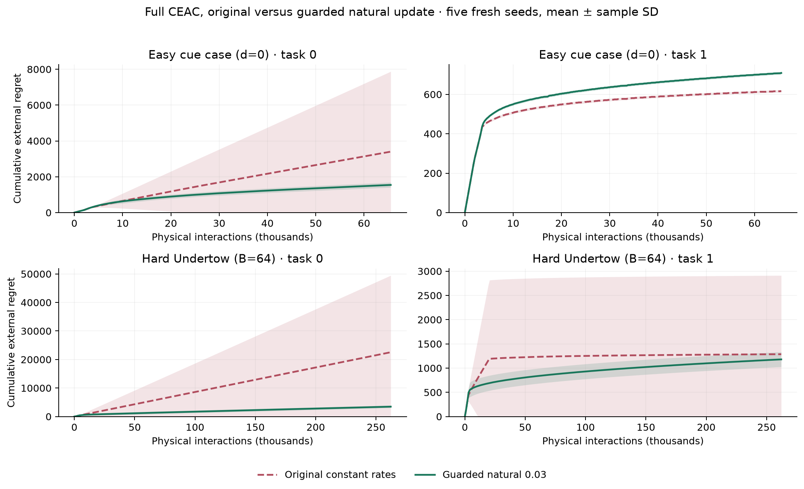
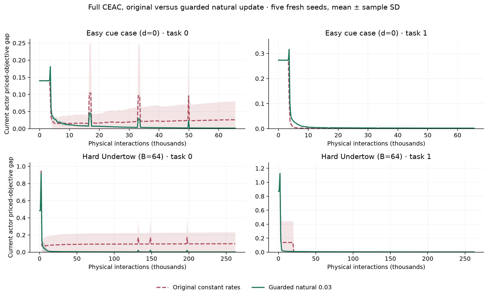
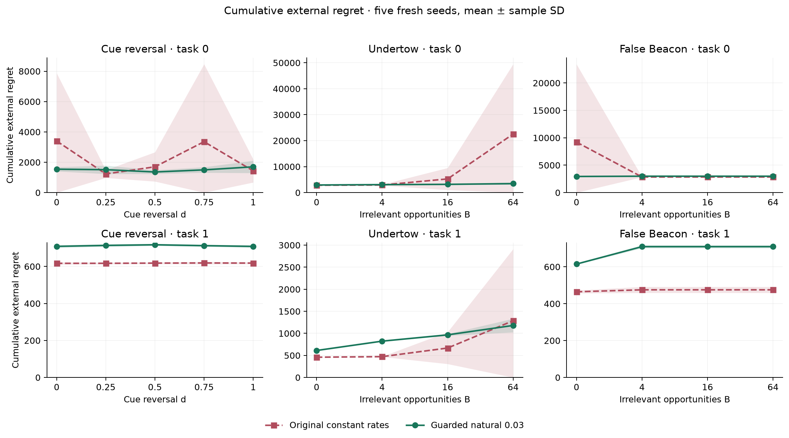
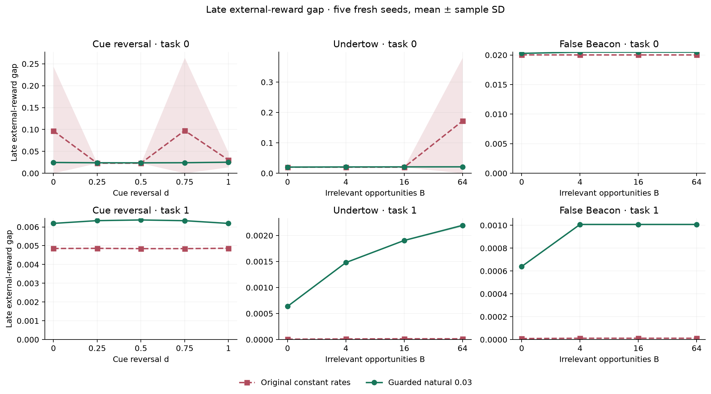
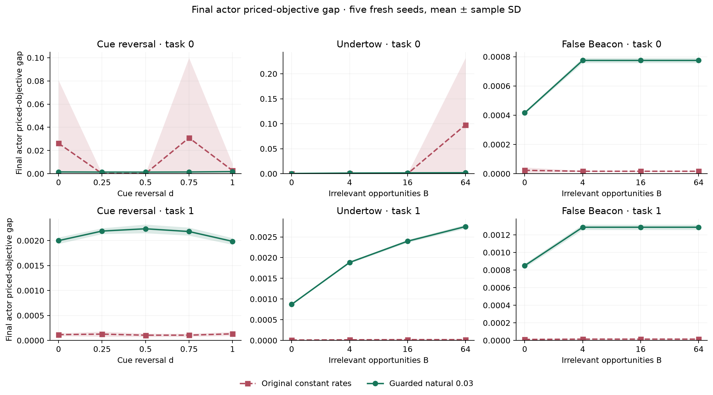
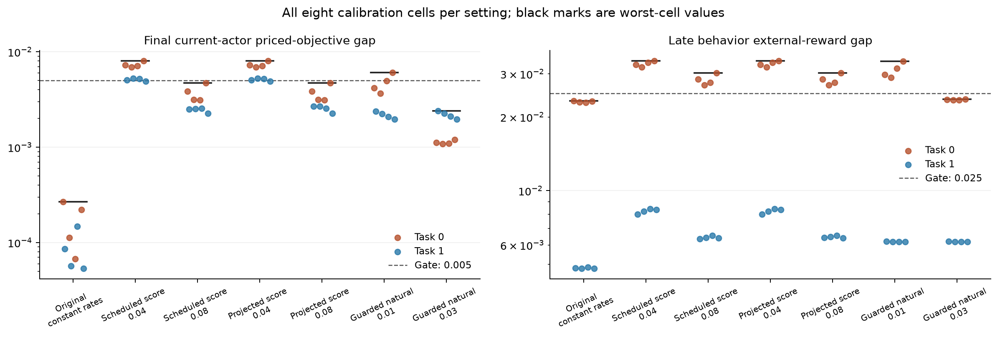
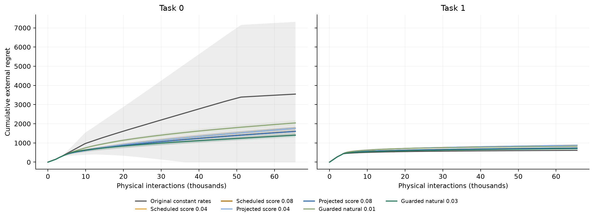

# CEAC actor stability: calibration and independent confirmation

**56 calibration cells; 260 completed fresh-seed confirmation cells.** Every setting retains both critics and evidence-priced policy-labeled replay.

**Primary decision: original_reference.** The frozen ranking minimizes worst-cell final actor priced-objective gap before considering cumulative external regret. No candidate, threshold or seed was changed after calibration.

The guarded natural 0.03 update also passed both calibration gates, with **49.3% lower mean calibration regret**. It had a larger final priced-objective gap, so it was not promoted by the primary rule. Endpoint accuracy and learning cost are distinct criteria.

## Fresh-seed secondary comparison

After calibration, and **before inspecting confirmation outcomes**, we registered a secondary rule: confirm every non-reference calibration passer on the already specified seeds, tasks, doses and budgets. Only guarded natural 0.03 qualified. The primary selection remains unchanged.

**Largest registered Undertow burden (B=64), task 0:** mean regret changes from 22,550 to 3,467 (84.6% lower). The worst actor priced-objective gap changes from 0.2471 to 0.0020. The original update can still fail at the longer budget; the natural update avoids those large optimization residuals in these five seeds.

**Fresh-seed cue result:** the worst task-0 actor priced-objective gap changes from 0.1542 to 0.0025. Using the calibration gap threshold (0.005) descriptively, 4/25 original cue cells and 0/25 natural cells exceed it. Lower cue regret occurs on 1/5 seed-averaged task-0 sequences: the mean benefit is driven by avoiding a costly failure, not consistently faster learning. The largest task-0 late reward gap changes from 0.3952 to 0.0270. Task 1 shows the cost of stabilization: mean late reward gap changes from 0.00485 to 0.00628; 98.5% of the natural update's mean final priced-objective gap is the cost of its imposed floor. This supports fewer large actor failures in the measured cue conditions, not universal improvement. Five seeds and their full paired dispersion are retained below.

Registered UTC: `2026-11-12T17:12:21.995254+00:00`. There are 130 original-reference and 130 guarded-natural cells, using seeds 3001–3005. Cue studies use 32,768 episodes; burden studies use 131,072. Every episode takes two physical interactions.



The easy cue baseline d=0 and maximum Undertow burden B=64 are registered endpoints. Both tasks and all seeds are shown; intermediate doses follow below. Each panel uses its own scale and the original family-specific budget. Lines are seed means and bands are one sample SD. Cumulative regret is the sum of expected episode reward gaps. Current-actor optimization error is evaluated against the currently priced objective; it is not external regret. Brief spikes coincide with replay recertification: prices temporarily become zero and the actor stays frozen, so the evaluated objective changes.



| Family | Task | Original regret | Natural regret | Paired difference ± SD | Mean late gap: original → natural |
|---|---:|---:|---:|---:|---:|
| False Beacon | 0 | 4,438.5 | **2,978.9** | -1,459.6 ± 3,550.8 | 0.02002 → 0.02044 |
| False Beacon | 1 | **472.5** | 685.6 | 213.1 ± 10.2 | 0.00001 → 0.00092 |
| Undertow | 0 | 8,394.7 | **3,161.8** | -5,232.9 ± 6,449.1 | 0.05801 → 0.02080 |
| Undertow | 1 | **721.5** | 895.3 | 173.8 ± 358.9 | 0.00001 → 0.00155 |
| Cue reversal | 0 | 2,224.3 | **1,522.7** | -701.6 ± 2,060.4 | 0.05413 → 0.02435 |
| Cue reversal | 1 | **617.8** | 712.0 | 94.2 ± 1.2 | 0.00485 → 0.00628 |

Each row averages all registered doses within a family/task. The paired SD is computed over five seed-level averages, retaining pairing across doses; doses are not treated as independent seeds. Negative differences favor the natural update. Bold means lower average regret, not statistical significance. Different families have different episode budgets.







All dose points are shown at equal horizontal spacing for legibility, with their actual values labeled. Error bands are one sample SD across five seeds, not confidence intervals. No external-method ranking is updated using these optimizer-only runs.

## Mechanism checks and remaining costs

| Family | Task | Optimizer | Maximum priced gap | Maximum gap above floor-constrained optimum | Mean forced-floor gap | Mean final nuisance mass |
|---|---:|---|---:|---:|---:|---:|
| Cue reversal | 0 | Original constant rates | 0.154236 | 0.154236 | 0.000000 | 0.000000 |
| Cue reversal | 0 | Guarded natural 0.03 | 0.002505 | 0.001378 | 0.001223 | 0.000000 |
| Cue reversal | 1 | Original constant rates | 0.000193 | 0.000193 | 0.000000 | 0.000000 |
| Cue reversal | 1 | Guarded natural 0.03 | 0.002350 | 0.000063 | 0.002086 | 0.000000 |
| Undertow | 0 | Original constant rates | 0.247071 | 0.247071 | 0.000000 | 0.000014 |
| Undertow | 0 | Guarded natural 0.03 | 0.001994 | 0.000154 | 0.001266 | 0.001427 |
| Undertow | 1 | Original constant rates | 0.000040 | 0.000040 | 0.000000 | 0.000010 |
| Undertow | 1 | Guarded natural 0.03 | 0.002790 | 0.000253 | 0.001902 | 0.001436 |
| False Beacon | 0 | Original constant rates | 0.000059 | 0.000059 | 0.000000 | 0.000005 |
| False Beacon | 0 | Guarded natural 0.03 | 0.000805 | 0.000006 | 0.000681 | 0.000436 |
| False Beacon | 1 | Original constant rates | 0.000018 | 0.000018 | 0.000000 | 0.000004 |
| False Beacon | 1 | Guarded natural 0.03 | 0.001312 | 0.000019 | 0.001166 | 0.000440 |

The total probability floor bounds forced nuisance mass independently of the action count, but it still imposes a finite-budget cost. The constrained gap subtracts only that feasible-policy cost. Persistent probe preference can remain even after actor optimization converges, because conservative replay prices may favor a probe with reward 0.48 over the safe route with reward 0.50.

The saved traces retain minimum propensity, entropy, Fisher conditioning, TD/gradient second moments, accepted-update KL, trust contractions, best-priced-action visits, evidence-price magnitude and floor mass. Final replay counts and policy probabilities are included in the portable evidence. These jointly changed optimizer settings do not isolate a causal contribution from preconditioning, critic scaling or the floor individually.

## Calibration and the frozen decision



| Optimizer setting | Worst final priced gap | Worst late reward gap | Mean accumulated regret | Passed both gates |
|---|---:|---:|---:|---:|---|
| **Original constant rates** | 0.000269 | 0.023227 | 2,081.5 | True |
| Scheduled score 0.04 | 0.008007 | 0.033836 | 1,325.3 | False |
| Scheduled score 0.08 | 0.004711 | 0.030236 | 1,172.0 | False |
| Projected score 0.04 | 0.008007 | 0.033836 | 1,325.3 | False |
| Projected score 0.08 | 0.004711 | 0.030236 | 1,172.8 | False |
| Guarded natural 0.01 | 0.006041 | 0.033697 | 1,434.6 | False |
| Guarded natural 0.03 | 0.002393 | 0.023652 | 1,056.0 | True |

Every calibration cell must have final actor priced-objective gap ≤ 0.005, late behavior reward gap ≤ 0.025, and nonzero-price actor updates. There are four seeds per task, two tasks, and 32,768 episodes per cell. The original reference is eligible under the frozen rule. These thresholds govern calibration, not a new pass/fail claim for all confirmation doses.



All settings are retained, including failed candidates. Slower score updates reduce some learning costs but miss the late reward-gap gate. The projected score updates closely track the ordinary scheduled paths; in these runs their floors rarely bind. The endpoint-first rule prefers the sharper final solution of the original update to the natural update’s learning-cost tradeoff.

## Implementation and reproducibility

The original setting reproduces frozen actor updates, raw trajectory text and replay design histories exactly in integration testing. Scheduled critics use both TD errors frozen before either critic update. Projected variants use actual KL projection, an annealed total probability floor and a KL bound checked after projection. The natural variant uses the fresh sampled TD error and on-policy propensity, never evaluator Q values.

Natural/projection variants are explicit optimizer extensions to complete CEAC. They are not the manuscript’s literal score-function update. The floor can add polynomial exploration cost; this experiment does not prove convergence or Graves–Lai optimal regret. Critic/replay prices and policy-label contracts remain intact. No actor-only ablation was introduced.

[Protocol and equations](../../../docs/actor_stability_protocol.md) · [Original failure diagnosis](../../../audits/ceac_actor_failure_20261112/assessment.md) · [Every endpoint](endpoints.csv) · [Paired differences](paired_differences.csv) · [Figures PDF](figures.pdf).

Reproduce from the repository root:

```bash
python -m ceac_stability.experiment pipeline --output runs/ceac_actor_stability_20261112 --workers 6
python scripts/run_actor_stability_secondary.py --study runs/ceac_actor_stability_20261112 --workers 6
python -m ceac_stability.report --study runs/ceac_actor_stability_20261112 --output notebooks/evidence/actor_stability
```

Completed cells and registrations are verified before reuse. Incomplete existing cells fail closed. Raw episodes, source bundles and original studies remain unchanged; compact evidence supports offline notebook rendering.
