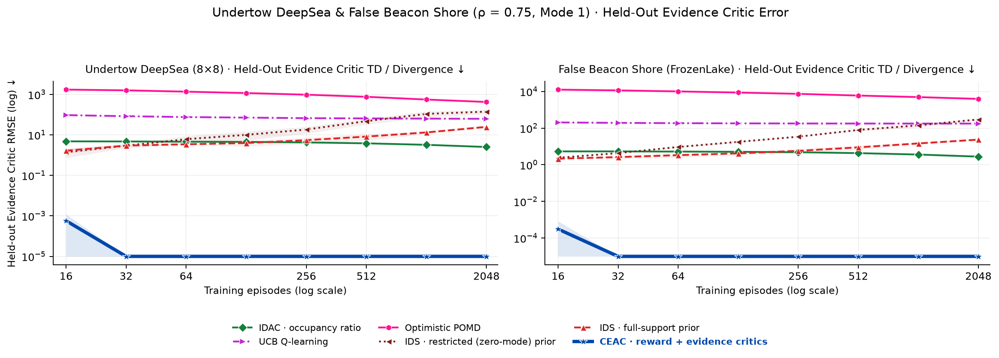
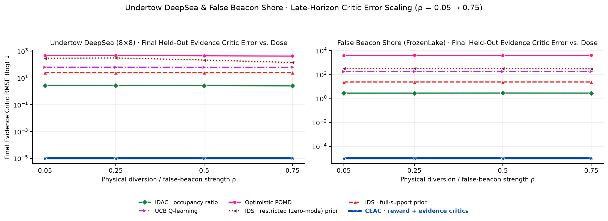
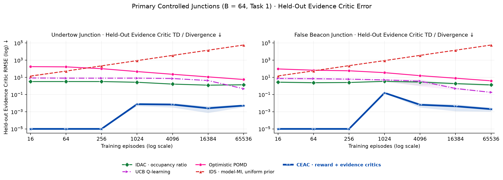
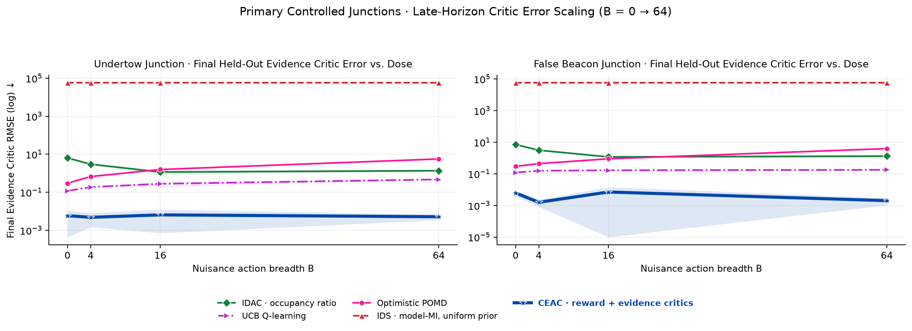
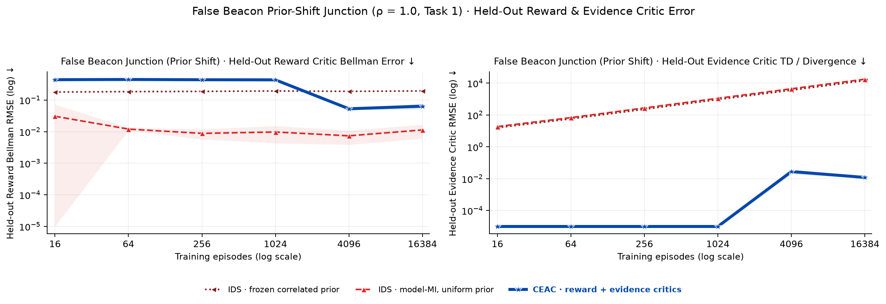

# Held-Out Reward & Evidence Critic TD / Bellman Diagnostics — Undertow & False Beacon Suites

Reconstructed **249** completed cells (`144` Grid DeepSea/FrozenLake cells + `60` Controlled Burden Junction cells + `45` Prior-Shift Junction cells) directly from immutable saved trajectories (`trajectories.jsonl` / `episodes.jsonl.gz`) with **zero new training** and exact policy-ID / update-count parity.

## 1. Grid Undertow DeepSea & False Beacon Shore (Mode 1, 2,048 Episodes)

| Environment | Algorithm | Reward Bellman RMSE (ρ=0.75, t=2,048) | Evidence Critic RMSE (ρ=0.05 → 0.75) | Bounded Stage-Critic RMSE (ρ=0.05 → 0.75) |
|---|---|---:|---:|---:|
| Undertow DeepSea (8×8) | IDAC · occupancy ratio | 0.7581 | 2.6308 → 2.5308 | 2.6308 → 2.5308 |
| Undertow DeepSea (8×8) | UCB Q-learning | 48.7514 | 63.1914 → 62.4204 | 63.1914 → 62.4204 |
| Undertow DeepSea (8×8) | Optimistic POMD | 0.5002 | 462.0090 → 423.5368 | 462.0090 → 423.5368 |
| Undertow DeepSea (8×8) | IDS · restricted (zero-mode) prior | 0.0138 | 292.3533 → 141.4146 | 0.1428 → 0.0691 |
| Undertow DeepSea (8×8) | IDS · full-support prior | 0.0321 | 24.9767 → 24.9767 | 0.0000 → 0.0000 |
| Undertow DeepSea (8×8) | CEAC · reward + evidence critics | 0.0100 | 0.0000 → 0.0000 | 0.0000 → 0.0000 |
| False Beacon Shore (FrozenLake) | IDAC · occupancy ratio | 0.9716 | 2.7651 → 2.7771 | 2.7651 → 2.7771 |
| False Beacon Shore (FrozenLake) | UCB Q-learning | 62.5279 | 176.5626 → 176.2377 | 176.5626 → 176.2377 |
| False Beacon Shore (FrozenLake) | Optimistic POMD | 1.0006 | 3,772.0982 → 3,922.9275 | 3772.0982 → 3922.9275 |
| False Beacon Shore (FrozenLake) | IDS · restricted (zero-mode) prior | 0.0082 | 309.9150 → 297.2702 | 0.1513 → 0.1452 |
| False Beacon Shore (FrozenLake) | IDS · full-support prior | 0.0205 | 23.5379 → 23.5379 | 0.0000 → 0.0000 |
| False Beacon Shore (FrozenLake) | CEAC · reward + evidence critics | 0.0029 | 0.0000 → 0.0000 | 0.0000 → 0.0000 |

## 2. Primary Controlled Junctions — Nuisance Breadth Sweep (Task 1, 65,536 Episodes)

| Environment | Algorithm | Reward Bellman RMSE (B=64, t=65,536) | Evidence Critic RMSE (B=0 → 64) | Bounded Stage-Critic RMSE (B=0 → 64) |
|---|---|---:|---:|---:|
| Undertow Junction | IDAC · occupancy ratio | 0.0498 | 6.3832 → 1.3632 | 6.3832 → 1.3632 |
| Undertow Junction | UCB Q-learning | 0.4849 | 0.1177 → 0.4720 | 0.1177 → 0.4720 |
| Undertow Junction | Optimistic POMD | 0.9900 | 0.2963 → 5.6478 | 0.2963 → 5.6478 |
| Undertow Junction | IDS · model-MI, uniform prior | 0.0057 | 57,517.6922 → 57,517.6922 | 0.0000 → 0.0000 |
| Undertow Junction | CEAC · reward + evidence critics | 0.0325 | 0.0059 → 0.0052 | 0.1492 → 0.1491 |
| False Beacon Junction | IDAC · occupancy ratio | 0.0644 | 7.1409 → 1.3127 | 7.1409 → 1.3127 |
| False Beacon Junction | UCB Q-learning | 0.1857 | 0.1201 → 0.1787 | 0.1201 → 0.1787 |
| False Beacon Junction | Optimistic POMD | 0.7938 | 0.2951 → 3.9422 | 0.2951 → 3.9422 |
| False Beacon Junction | IDS · model-MI, uniform prior | 0.0041 | 57,543.1145 → 57,543.1145 | 0.0000 → 0.0000 |
| False Beacon Junction | CEAC · reward + evidence critics | 0.0354 | 0.0062 → 0.0020 | 0.1528 → 0.1527 |

## 3. Primary Prior-Shift Junctions — Cue Reversal Sweep (Task 1, 16,384 Episodes)

| Environment | Algorithm | Reward Bellman RMSE (ρ=1, t=16,384) | Evidence Critic RMSE (ρ=0 → 1) | Bounded Stage-Critic RMSE (ρ=0 → 1) |
|---|---|---:|---:|---:|
| False Beacon Junction (Prior Shift) | IDS · frozen correlated prior | 0.1942 | 28,754.3456 → 14,661.7878 | 0.0000 → 0.8949 |
| False Beacon Junction (Prior Shift) | IDS · model-MI, uniform prior | 0.0114 | 17,741.4923 → 17,725.4453 | 0.0000 → 0.0000 |
| False Beacon Junction (Prior Shift) | CEAC · reward + evidence critics | 0.0641 | 0.0160 → 0.0120 | 0.3069 → 0.3084 |
