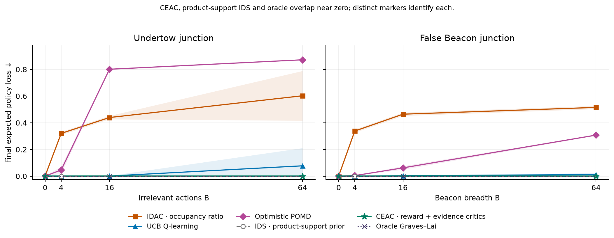
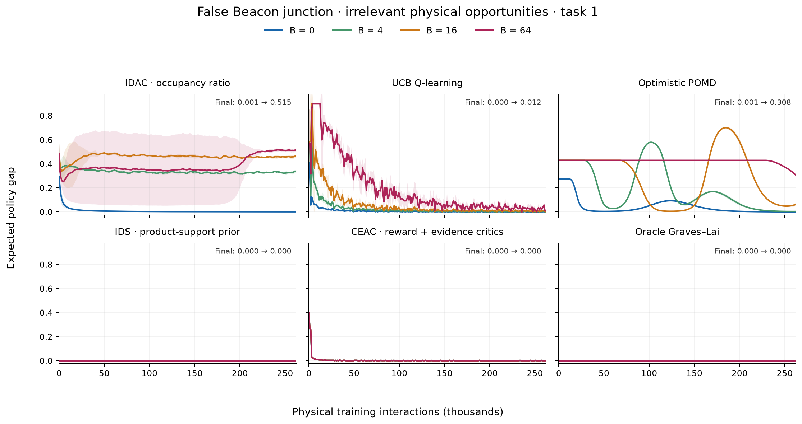
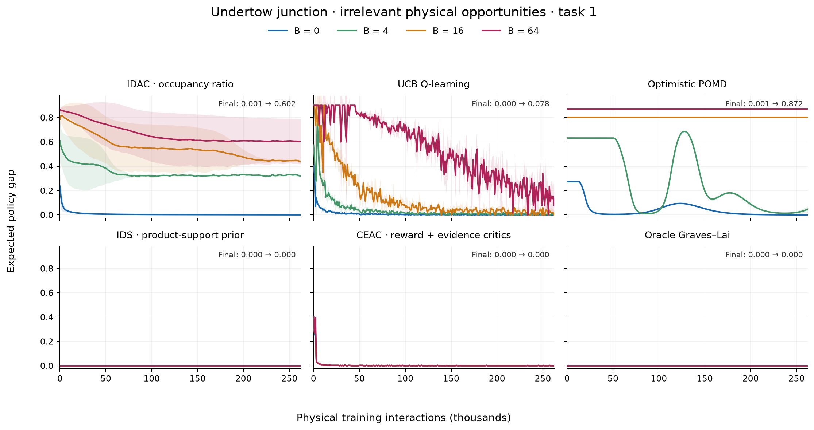

# Physical exploration burden

Verified 144 completed cells; 3 held-out seeds per cell; 131,072 two-step episodes. No training is launched by report rendering.

Each panel follows one algorithm as dose changes. Lines are seed means; shading is one sample standard deviation across seeds, not a confidence interval. Coincident lines indicate similar measured behavior. Lower policy gap is better. Endpoint gap averages the final 256 episodes.

These are new short junction variants. They do not establish the same result on the historical DeepSea/Frozen Lake grids. Task 1 is the burden study’s primary scope; both tasks are retained in the prior-shift study. The two burden variants share the same zero-burden kernel.

## Dose response

## Within-algorithm learning traces

## Measured changes from the weakest to strongest dose (task 1)

| Variant | Algorithm | Final gap: weakest → strongest | Cumulative regret: weakest → strongest |
|---|---|---:|---:|
| False Beacon junction | CEAC · reward + evidence critics | 0.0000 → 0.0000 | 462.0 → 470.0 |
| False Beacon junction | IDAC · occupancy ratio | 0.0013 → 0.5152 | 1013.4 → 50496.5 |
| False Beacon junction | IDS · product-support prior | 0.0000 → 0.0000 | 0.0 → 0.0 |
| False Beacon junction | Oracle Graves–Lai | 0.0000 → 0.0000 | 0.0 → 0.0 |
| False Beacon junction | Optimistic POMD | 0.0006 → 0.3078 | 5804.4 → 55604.0 |
| False Beacon junction | UCB Q-learning | 0.0000 → 0.0122 | 1165.9 → 25516.3 |
| Undertow junction | CEAC · reward + evidence critics | 0.0000 → 0.0000 | 460.6 → 623.1 |
| Undertow junction | IDAC · occupancy ratio | 0.0013 → 0.6024 | 852.1 → 87060.1 |
| Undertow junction | IDS · product-support prior | 0.0000 → 0.0000 | 0.7 → 0.7 |
| Undertow junction | Oracle Graves–Lai | 0.0000 → 0.0000 | 0.0 → 0.0 |
| Undertow junction | Optimistic POMD | 0.0006 → 0.8719 | 5800.1 → 114287.0 |
| Undertow junction | UCB Q-learning | 0.0000 → 0.0777 | 1172.4 → 70007.8 |

Persistent endpoint loss and larger accumulated learning cost are different findings. A control that eventually recovers must not be described as permanently failing.

## Complete dose table

| Variant | Task | Algorithm | Dose | Final policy gap, mean ± SD | Cumulative regret | Nuisance episodes |
|---|---:|---|---:|---:|---:|---:|
| False Beacon junction | 1 | CEAC · reward + evidence critics | 0 | 0.0000 ± 0.0000 | 462.0 | 0.0% |
| False Beacon junction | 1 | CEAC · reward + evidence critics | 4 | 0.0000 ± 0.0000 | 470.0 | 0.0% |
| False Beacon junction | 1 | CEAC · reward + evidence critics | 16 | 0.0000 ± 0.0000 | 470.0 | 0.0% |
| False Beacon junction | 1 | CEAC · reward + evidence critics | 64 | 0.0000 ± 0.0000 | 470.0 | 0.0% |
| False Beacon junction | 1 | IDAC · occupancy ratio | 0 | 0.0013 ± 0.0001 | 1013.4 | 0.0% |
| False Beacon junction | 1 | IDAC · occupancy ratio | 4 | 0.3383 ± 0.0117 | 43963.4 | 35.6% |
| False Beacon junction | 1 | IDAC · occupancy ratio | 16 | 0.4646 ± 0.0123 | 60139.6 | 49.2% |
| False Beacon junction | 1 | IDAC · occupancy ratio | 64 | 0.5152 ± 0.0118 | 50496.5 | 41.2% |
| False Beacon junction | 1 | IDS · product-support prior | 0 | 0.0000 ± 0.0000 | 0.0 | 0.0% |
| False Beacon junction | 1 | IDS · product-support prior | 4 | 0.0000 ± 0.0000 | 0.0 | 0.0% |
| False Beacon junction | 1 | IDS · product-support prior | 16 | 0.0000 ± 0.0000 | 0.0 | 0.0% |
| False Beacon junction | 1 | IDS · product-support prior | 64 | 0.0000 ± 0.0000 | 0.0 | 0.0% |
| False Beacon junction | 1 | Oracle Graves–Lai | 0 | 0.0000 ± 0.0000 | 0.0 | 0.0% |
| False Beacon junction | 1 | Oracle Graves–Lai | 4 | 0.0000 ± 0.0000 | 0.0 | 0.0% |
| False Beacon junction | 1 | Oracle Graves–Lai | 16 | 0.0000 ± 0.0000 | 0.0 | 0.0% |
| False Beacon junction | 1 | Oracle Graves–Lai | 64 | 0.0000 ± 0.0000 | 0.0 | 0.0% |
| False Beacon junction | 1 | Optimistic POMD | 0 | 0.0006 ± 0.0001 | 5804.4 | 0.0% |
| False Beacon junction | 1 | Optimistic POMD | 4 | 0.0045 ± 0.0004 | 24935.2 | 13.6% |
| False Beacon junction | 1 | Optimistic POMD | 16 | 0.0625 ± 0.0131 | 38061.5 | 24.0% |
| False Beacon junction | 1 | Optimistic POMD | 64 | 0.3078 ± 0.0032 | 55604.0 | 24.1% |
| False Beacon junction | 1 | UCB Q-learning | 0 | 0.0000 ± 0.0000 | 1165.9 | 0.0% |
| False Beacon junction | 1 | UCB Q-learning | 4 | 0.0005 ± 0.0009 | 3532.5 | 2.0% |
| False Beacon junction | 1 | UCB Q-learning | 16 | 0.0034 ± 0.0029 | 8258.8 | 5.9% |
| False Beacon junction | 1 | UCB Q-learning | 64 | 0.0122 ± 0.0108 | 25516.3 | 20.5% |
| Undertow junction | 1 | CEAC · reward + evidence critics | 0 | 0.0000 ± 0.0000 | 460.6 | 0.0% |
| Undertow junction | 1 | CEAC · reward + evidence critics | 4 | 0.0000 ± 0.0000 | 479.4 | 0.0% |
| Undertow junction | 1 | CEAC · reward + evidence critics | 16 | 0.0000 ± 0.0000 | 518.8 | 0.1% |
| Undertow junction | 1 | CEAC · reward + evidence critics | 64 | 0.0000 ± 0.0000 | 623.1 | 0.2% |
| Undertow junction | 1 | IDAC · occupancy ratio | 0 | 0.0013 ± 0.0001 | 852.1 | 0.0% |
| Undertow junction | 1 | IDAC · occupancy ratio | 4 | 0.3207 ± 0.0115 | 45413.4 | 36.1% |
| Undertow junction | 1 | IDAC · occupancy ratio | 16 | 0.4395 ± 0.0128 | 72356.1 | 58.5% |
| Undertow junction | 1 | IDAC · occupancy ratio | 64 | 0.6024 ± 0.1861 | 87060.1 | 72.0% |
| Undertow junction | 1 | IDS · product-support prior | 0 | 0.0000 ± 0.0000 | 0.7 | 0.0% |
| Undertow junction | 1 | IDS · product-support prior | 4 | 0.0000 ± 0.0000 | 0.7 | 0.0% |
| Undertow junction | 1 | IDS · product-support prior | 16 | 0.0000 ± 0.0000 | 0.7 | 0.0% |
| Undertow junction | 1 | IDS · product-support prior | 64 | 0.0000 ± 0.0000 | 0.7 | 0.0% |
| Undertow junction | 1 | Oracle Graves–Lai | 0 | 0.0000 ± 0.0000 | 0.0 | 0.0% |
| Undertow junction | 1 | Oracle Graves–Lai | 4 | 0.0000 ± 0.0000 | 0.0 | 0.0% |
| Undertow junction | 1 | Oracle Graves–Lai | 16 | 0.0000 ± 0.0000 | 0.0 | 0.0% |
| Undertow junction | 1 | Oracle Graves–Lai | 64 | 0.0000 ± 0.0000 | 0.0 | 0.0% |
| Undertow junction | 1 | Optimistic POMD | 0 | 0.0006 ± 0.0002 | 5800.1 | 0.0% |
| Undertow junction | 1 | Optimistic POMD | 4 | 0.0465 ± 0.0259 | 36100.8 | 23.6% |
| Undertow junction | 1 | Optimistic POMD | 16 | 0.8011 ± 0.0000 | 104995.6 | 84.2% |
| Undertow junction | 1 | Optimistic POMD | 64 | 0.8719 ± 0.0000 | 114287.0 | 95.5% |
| Undertow junction | 1 | UCB Q-learning | 0 | 0.0000 ± 0.0000 | 1172.4 | 0.0% |
| Undertow junction | 1 | UCB Q-learning | 4 | 0.0011 ± 0.0018 | 5230.5 | 3.4% |
| Undertow junction | 1 | UCB Q-learning | 16 | 0.0011 ± 0.0018 | 18449.0 | 14.5% |
| Undertow junction | 1 | UCB Q-learning | 64 | 0.0777 ± 0.1331 | 70007.8 | 58.3% |

## What the evidence permits

The primitive controls receive trajectories and public action/state masks. IDS and CEAC receive declared candidate likelihoods and exact model-based policy responses. The oracle additionally receives the realized task/model. These are different information assumptions, not a matched model-free architecture comparison.

Primary CEAC uses the manuscript’s reward critic, price-conditioned evidence critic, and policy-labeled replay master. Statistical debt and design debt precede the actor; there is no exact-deployment branch. Exact model responses serve global certificates and target calibration. Oracle Graves–Lai additionally receives the true model. Historical exact-deployment results are excluded from this primary comparison.

CEAC made 2925360 actor updates in total, 2925360 with nonzero evidence prices. This does not isolate a learned-critic or replay-buffer causal contribution.

Full individual-seed endpoints are in `endpoints.json`/`endpoints.csv`; all registered conditions are retained. Three seeds support a descriptive initial study, not a population-level performance guarantee.
