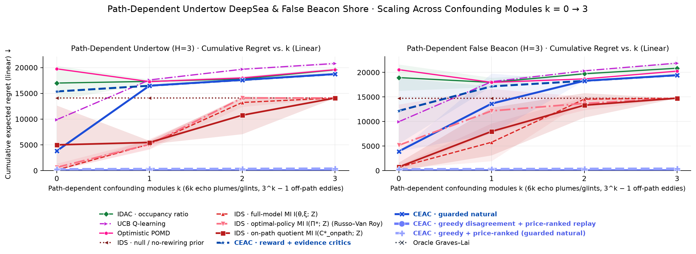
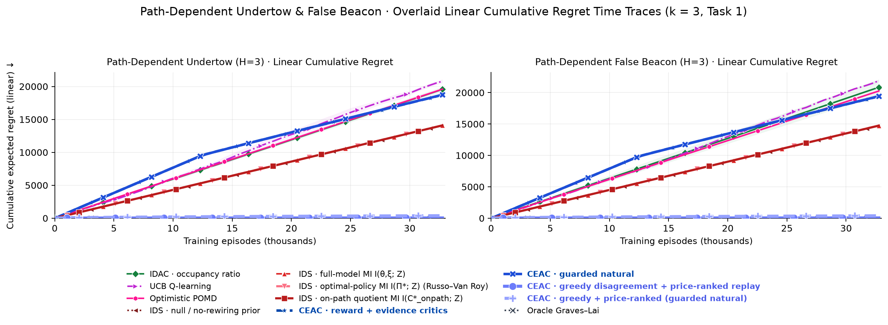
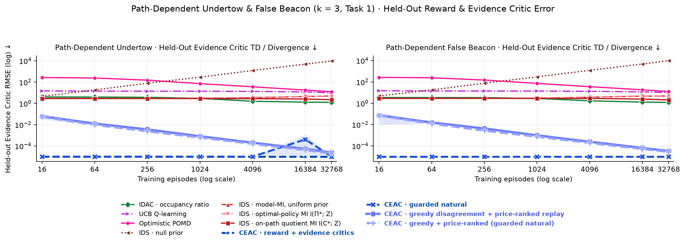
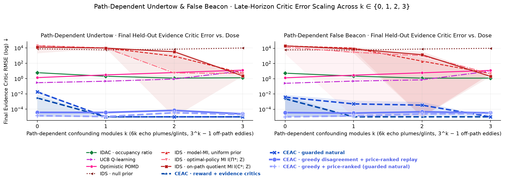

# Path-Dependent Undertow DeepSea & False Beacon Shore (`ceac_pathdep_grids`)

Evaluated **288** held-out cells (`seeds = 0, 1, 2`, `32,768` episodes / `98,304` physical steps per cell) across path-dependent confounding complexity `k ∈ {0, 1, 2, 3}`.

| Benchmark | Algorithm | Final Gap (k=0 → k=3) | Regret (k=0 → k=3) | Evidence Critic RMSE (k=3) |
|---|---|---:|---:|---:|
| Path-Dependent Undertow DeepSea (Thermocline Lock, H = 3) | IDAC · occupancy ratio | 0.4854 → 0.6025 | 16,995.0 → 19,560.4 | 1.2639 |
| Path-Dependent Undertow DeepSea (Thermocline Lock, H = 3) | UCB Q-learning | 0.1567 → 0.5214 | 9,888.3 → 20,790.5 | 9.8944 |
| Path-Dependent Undertow DeepSea (Thermocline Lock, H = 3) | Optimistic POMD | 0.6680 → 0.5980 | 19,751.9 → 19,593.9 | 12.5362 |
| Path-Dependent Undertow DeepSea (Thermocline Lock, H = 3) | IDS · null / no-rewiring prior | 0.4300 → 0.4300 | 14,090.2 → 14,090.2 | 9,673.8705 |
| Path-Dependent Undertow DeepSea (Thermocline Lock, H = 3) | IDS · full-model MI I(θ,ξ; Z) | 0.0000 → 0.4300 | 131.6 → 14,092.8 | 4.9699 |
| Path-Dependent Undertow DeepSea (Thermocline Lock, H = 3) | IDS · optimal-policy MI I(Π*; Z) (Russo–Van Roy) | 0.0000 → 0.4300 | 634.1 → 14,092.4 | 4.6564 |
| Path-Dependent Undertow DeepSea (Thermocline Lock, H = 3) | IDS · on-path quotient MI I(C*_onpath; Z) | 0.0000 → 0.4300 | 4,995.1 → 14,090.6 | 2.2325 |
| Path-Dependent Undertow DeepSea (Thermocline Lock, H = 3) | CEAC · reward + evidence critics | 0.4402 → 0.4670 | 15,362.2 → 18,725.2 | 0.0000 |
| Path-Dependent Undertow DeepSea (Thermocline Lock, H = 3) | CEAC · guarded natural | 0.0317 → 0.4678 | 3,822.7 → 18,741.4 | 0.0000 |
| Path-Dependent Undertow DeepSea (Thermocline Lock, H = 3) | CEAC · greedy disagreement + price-ranked replay | 0.0001 → 0.0001 | 33.4 → 37.4 | 0.0000 |
| Path-Dependent Undertow DeepSea (Thermocline Lock, H = 3) | CEAC · greedy + price-ranked (guarded natural) | 0.0046 → 0.0062 | 256.3 → 383.4 | 0.0000 |
| Path-Dependent Undertow DeepSea (Thermocline Lock, H = 3) | Oracle Graves–Lai | 0.0000 → 0.0000 | 0.0 → 0.0 | — |
| Path-Dependent False Beacon Shore (Icebreaker Staging, H = 3) | IDAC · occupancy ratio | 0.5215 → 0.6390 | 18,941.3 → 20,848.9 | 1.2166 |
| Path-Dependent False Beacon Shore (Icebreaker Staging, H = 3) | UCB Q-learning | 0.1331 → 0.7642 | 9,955.2 → 21,890.8 | 10.2416 |
| Path-Dependent False Beacon Shore (Icebreaker Staging, H = 3) | Optimistic POMD | 0.6927 → 0.6182 | 20,551.5 → 20,257.2 | 12.5593 |
| Path-Dependent False Beacon Shore (Icebreaker Staging, H = 3) | IDS · null / no-rewiring prior | 0.4500 → 0.4500 | 14,745.6 → 14,745.6 | 9,941.6434 |
| Path-Dependent False Beacon Shore (Icebreaker Staging, H = 3) | IDS · full-model MI I(θ,ξ; Z) | 0.0000 → 0.4500 | 677.4 → 14,747.9 | 4.8306 |
| Path-Dependent False Beacon Shore (Icebreaker Staging, H = 3) | IDS · optimal-policy MI I(Π*; Z) (Russo–Van Roy) | 0.1500 → 0.4500 | 5,157.9 → 14,749.0 | 4.6675 |
| Path-Dependent False Beacon Shore (Icebreaker Staging, H = 3) | IDS · on-path quotient MI I(C*_onpath; Z) | 0.0000 → 0.4500 | 738.3 → 14,745.9 | 2.0705 |
| Path-Dependent False Beacon Shore (Icebreaker Staging, H = 3) | CEAC · reward + evidence critics | 0.3163 → 0.4872 | 12,181.9 → 19,411.0 | 0.0000 |
| Path-Dependent False Beacon Shore (Icebreaker Staging, H = 3) | CEAC · guarded natural | 0.0329 → 0.4880 | 3,924.5 → 19,428.0 | 0.0000 |
| Path-Dependent False Beacon Shore (Icebreaker Staging, H = 3) | CEAC · greedy disagreement + price-ranked replay | 0.0001 → 0.0001 | 40.1 → 44.7 | 0.0000 |
| Path-Dependent False Beacon Shore (Icebreaker Staging, H = 3) | CEAC · greedy + price-ranked (guarded natural) | 0.0047 → 0.0065 | 268.1 → 386.9 | 0.0000 |
| Path-Dependent False Beacon Shore (Icebreaker Staging, H = 3) | Oracle Graves–Lai | 0.0000 → 0.0000 | 0.0 → 0.0 | — |
