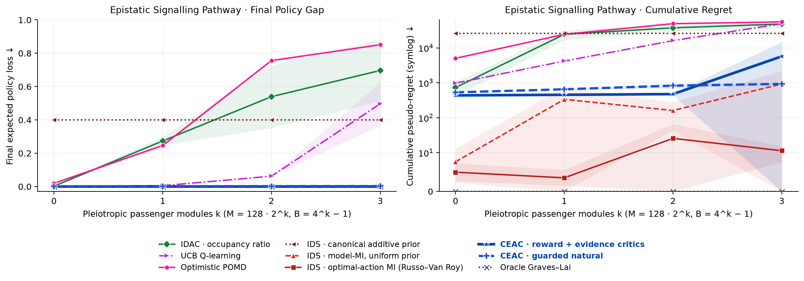
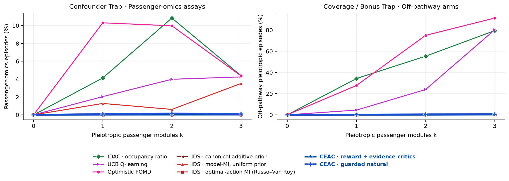
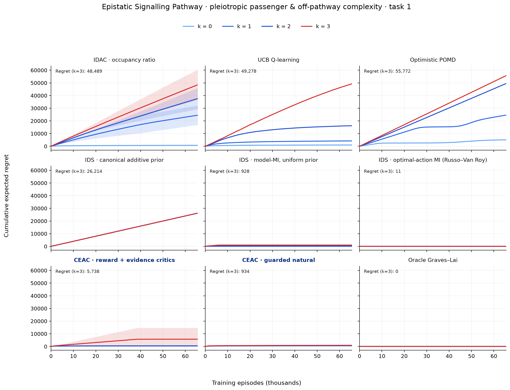
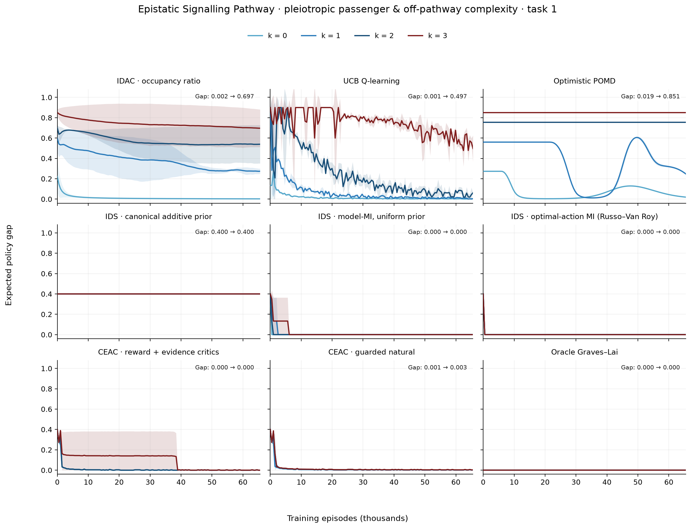
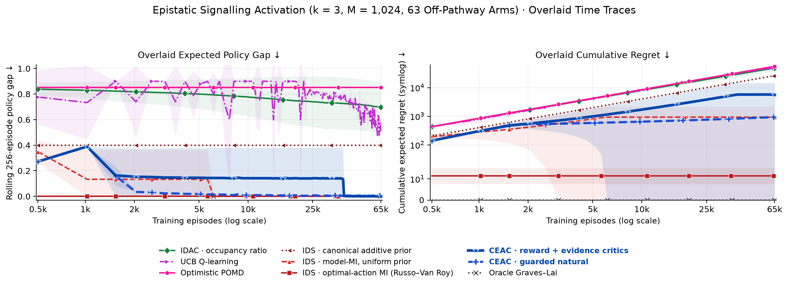
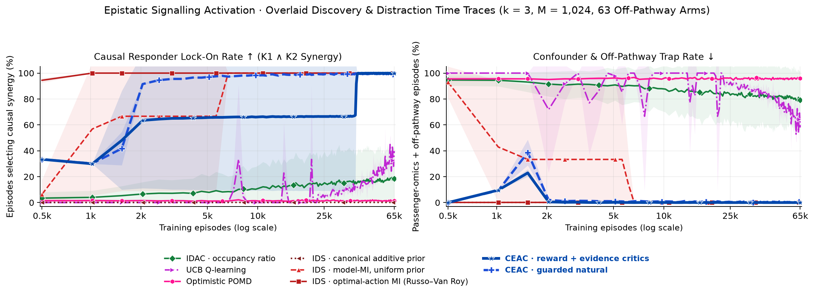
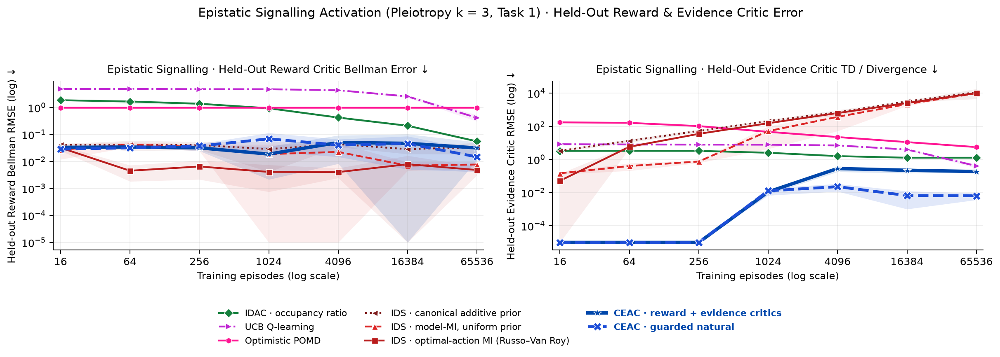
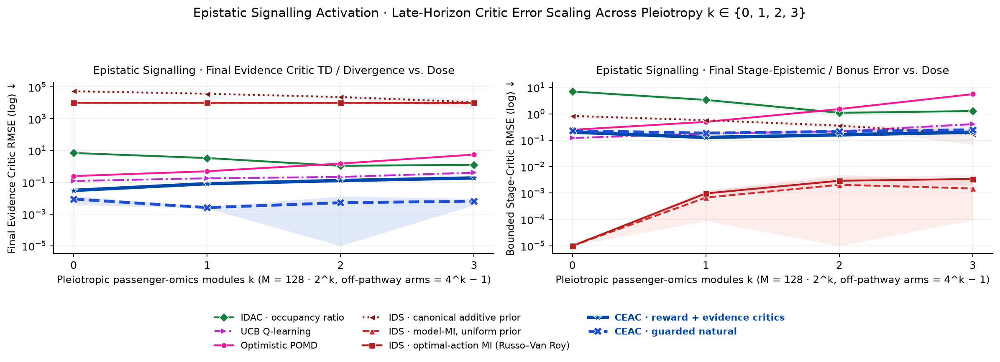

# Epistatic Signalling Pathway Discovery under Pleiotropic Confounding

Verified **108** completed cells (3 held-out seeds per condition, 65,536 episodes per run). Independent easy-case calibration passed before sweep execution.

## Headline Dose Response (Task 1)

## Mechanism Diagnostics

## Within-Algorithm Learning Fans

## Overlaid Performance & Discovery-Process Time Traces

## Weakest-to-Strongest Pathology Summary (Task 1)

| Environment | Algorithm | Final gap: min → max | Regret: min → max | Primary distraction (max dose) |
|---|---|---:|---:|---:|
| Epistatic Signalling Pathway | IDAC · occupancy ratio | 0.0024 → 0.6967 | 734.1 → 48,489.0 | omics 4.39% / pleio 79.5% |
| Epistatic Signalling Pathway | UCB Q-learning | 0.0011 → 0.4967 | 983.5 → 49,277.5 | omics 4.25% / pleio 80.3% |
| Epistatic Signalling Pathway | Optimistic POMD | 0.0192 → 0.8510 | 5,046.8 → 55,772.4 | omics 4.36% / pleio 91.4% |
| Epistatic Signalling Pathway | IDS · canonical additive prior | 0.4000 → 0.4000 | 26,214.4 → 26,214.4 | omics 0.00% / pleio 0.0% |
| Epistatic Signalling Pathway | IDS · model-MI, uniform prior | 0.0000 → 0.0000 | 7.7 → 928.2 | omics 3.52% / pleio 0.0% |
| Epistatic Signalling Pathway | IDS · optimal-action MI (Russo–Van Roy) | 0.0000 → 0.0000 | 5.0 → 11.4 | omics 0.00% / pleio 0.0% |
| Epistatic Signalling Pathway | CEAC · reward + evidence critics | 0.0000 → 0.0000 | 438.5 → 5,738.1 | omics 0.02% / pleio 0.3% |
| Epistatic Signalling Pathway | CEAC · guarded natural | 0.0009 → 0.0030 | 536.1 → 934.0 | omics 0.11% / pleio 0.8% |
| Epistatic Signalling Pathway | Oracle Graves–Lai | 0.0000 → 0.0000 | 0.0 → 0.0 | omics 0.00% / pleio 0.0% |

## Paired CEAC Advantage at Maximum Pathology (Dose = 3, Task 1)

| Environment | Comparator | Regret saved vs CEAC (mean ± SD) | Added advantage over min dose | CEAC lower on all seeds |
|---|---|---:|---:|---|
| Epistatic Signalling Pathway | IDAC · occupancy ratio | +42,751.0 ± 10,010.6 | +42,455.3 ± 9,775.9 | True |
| Epistatic Signalling Pathway | UCB Q-learning | +43,539.5 ± 8,867.5 | +42,994.4 ± 8,840.1 | True |
| Epistatic Signalling Pathway | Optimistic POMD | +50,034.3 ± 8,943.9 | +45,425.9 ± 8,956.0 | True |
| Epistatic Signalling Pathway | IDS · canonical additive prior | +20,476.3 ± 8,943.9 | -5,299.6 ± 8,945.0 | True |
| Epistatic Signalling Pathway | IDS · model-MI, uniform prior | -4,809.8 ± 9,659.7 | -4,379.0 ± 9,663.4 | False |
| Epistatic Signalling Pathway | IDS · optimal-action MI (Russo–Van Roy) | -5,726.6 ± 8,940.5 | -5,293.2 ± 8,942.2 | False |
| Epistatic Signalling Pathway | CEAC · guarded natural | -4,804.1 ± 8,928.5 | -4,901.8 ± 8,930.5 | False |
| Epistatic Signalling Pathway | Oracle Graves–Lai | -5,738.1 ± 8,943.9 | -5,299.6 ± 8,945.0 | False |

## Complete Endpoint Table

| Environment | Task | Algorithm | Dose | Final gap (mean ± SD) | Cumulative regret (mean ± SD) |
|---|---:|---|---:|---:|---:|
| Epistatic Signalling Pathway | 1 | CEAC · reward + evidence critics | 0 | 0.0000 ± 0.0000 | 438.5 ± 5.2 |
| Epistatic Signalling Pathway | 1 | CEAC · reward + evidence critics | 1 | 0.0000 ± 0.0000 | 456.3 ± 18.9 |
| Epistatic Signalling Pathway | 1 | CEAC · reward + evidence critics | 2 | 0.0000 ± 0.0000 | 477.3 ± 30.9 |
| Epistatic Signalling Pathway | 1 | CEAC · reward + evidence critics | 3 | 0.0000 ± 0.0000 | 5,738.1 ± 8,943.9 |
| Epistatic Signalling Pathway | 1 | CEAC · guarded natural | 0 | 0.0009 ± 0.0000 | 536.1 ± 1.1 |
| Epistatic Signalling Pathway | 1 | CEAC · guarded natural | 1 | 0.0018 ± 0.0000 | 656.2 ± 6.8 |
| Epistatic Signalling Pathway | 1 | CEAC · guarded natural | 2 | 0.0025 ± 0.0000 | 832.6 ± 129.4 |
| Epistatic Signalling Pathway | 1 | CEAC · guarded natural | 3 | 0.0030 ± 0.0000 | 934.0 ± 34.6 |
| Epistatic Signalling Pathway | 1 | IDAC · occupancy ratio | 0 | 0.0024 ± 0.0002 | 734.1 ± 331.6 |
| Epistatic Signalling Pathway | 1 | IDAC · occupancy ratio | 1 | 0.2738 ± 0.0260 | 24,508.0 ± 7,664.8 |
| Epistatic Signalling Pathway | 1 | IDAC · occupancy ratio | 2 | 0.5393 ± 0.1881 | 37,652.4 ± 8,300.3 |
| Epistatic Signalling Pathway | 1 | IDAC · occupancy ratio | 3 | 0.6967 ± 0.1845 | 48,489.0 ± 11,896.8 |
| Epistatic Signalling Pathway | 1 | IDS · optimal-action MI (Russo–Van Roy) | 0 | 0.0000 ± 0.0000 | 5.0 ± 2.3 |
| Epistatic Signalling Pathway | 1 | IDS · optimal-action MI (Russo–Van Roy) | 1 | 0.0000 ± 0.0000 | 3.5 ± 2.0 |
| Epistatic Signalling Pathway | 1 | IDS · optimal-action MI (Russo–Van Roy) | 2 | 0.0000 ± 0.0000 | 25.8 ± 40.1 |
| Epistatic Signalling Pathway | 1 | IDS · optimal-action MI (Russo–Van Roy) | 3 | 0.0000 ± 0.0000 | 11.4 ± 3.8 |
| Epistatic Signalling Pathway | 1 | IDS · canonical additive prior | 0 | 0.4000 ± 0.0000 | 26,214.4 ± 0.0 |
| Epistatic Signalling Pathway | 1 | IDS · canonical additive prior | 1 | 0.4000 ± 0.0000 | 26,214.4 ± 0.0 |
| Epistatic Signalling Pathway | 1 | IDS · canonical additive prior | 2 | 0.4000 ± 0.0000 | 26,214.4 ± 0.0 |
| Epistatic Signalling Pathway | 1 | IDS · canonical additive prior | 3 | 0.4000 ± 0.0000 | 26,214.4 ± 0.0 |
| Epistatic Signalling Pathway | 1 | IDS · model-MI, uniform prior | 0 | 0.0000 ± 0.0000 | 7.7 ± 5.4 |
| Epistatic Signalling Pathway | 1 | IDS · model-MI, uniform prior | 1 | 0.0000 ± 0.0000 | 338.3 ± 428.6 |
| Epistatic Signalling Pathway | 1 | IDS · model-MI, uniform prior | 2 | 0.0000 ± 0.0000 | 161.7 ± 117.9 |
| Epistatic Signalling Pathway | 1 | IDS · model-MI, uniform prior | 3 | 0.0000 ± 0.0000 | 928.2 ± 1,235.7 |
| Epistatic Signalling Pathway | 1 | Oracle Graves–Lai | 0 | 0.0000 ± 0.0000 | 0.0 ± 0.0 |
| Epistatic Signalling Pathway | 1 | Oracle Graves–Lai | 1 | 0.0000 ± 0.0000 | 0.0 ± 0.0 |
| Epistatic Signalling Pathway | 1 | Oracle Graves–Lai | 2 | 0.0000 ± 0.0000 | 0.0 ± 0.0 |
| Epistatic Signalling Pathway | 1 | Oracle Graves–Lai | 3 | 0.0000 ± 0.0000 | 0.0 ± 0.0 |
| Epistatic Signalling Pathway | 1 | Optimistic POMD | 0 | 0.0192 ± 0.0012 | 5,046.8 ± 19.6 |
| Epistatic Signalling Pathway | 1 | Optimistic POMD | 1 | 0.2466 ± 0.0078 | 24,544.6 ± 37.7 |
| Epistatic Signalling Pathway | 1 | Optimistic POMD | 2 | 0.7560 ± 0.0000 | 49,545.9 ± 0.0 |
| Epistatic Signalling Pathway | 1 | Optimistic POMD | 3 | 0.8510 ± 0.0000 | 55,772.4 ± 0.0 |
| Epistatic Signalling Pathway | 1 | UCB Q-learning | 0 | 0.0011 ± 0.0018 | 983.5 ± 51.3 |
| Epistatic Signalling Pathway | 1 | UCB Q-learning | 1 | 0.0056 ± 0.0072 | 4,208.4 ± 58.5 |
| Epistatic Signalling Pathway | 1 | UCB Q-learning | 2 | 0.0622 ± 0.0016 | 16,196.6 ± 85.8 |
| Epistatic Signalling Pathway | 1 | UCB Q-learning | 3 | 0.4967 ± 0.1287 | 49,277.5 ± 114.6 |

## Held-Out Reward & Evidence Critic TD / Bellman Diagnostics

Evaluated all **96** non-oracle `Task 1` sweep cells across log-spaced checkpoints `t ∈ {16 .. 65,536}` on independent held-out rollouts (`512` on-policy + `256` uniform-probe episodes per checkpoint; bit-exact cumulative-regret parity verified `< 1e-6` against `evidence.json.gz`).

| Environment | Algorithm | Reward Bellman RMSE (k=3, t=65,536) | Evidence Critic RMSE (k=0 → 3) | Active / Stage Critic RMSE (k=0 → 3) |
|---|---|---:|---:|---:|
| Epistatic Signalling | IDAC · occupancy ratio | 0.0556 | 7.0087 → 1.2746 | 7.0087 → 1.2746 |
| Epistatic Signalling | UCB Q-learning | 0.4140 | 0.1214 → 0.4068 | 0.1214 → 0.4068 |
| Epistatic Signalling | Optimistic POMD | 0.9832 | 0.2474 → 5.5634 | 0.2474 → 5.5634 |
| Epistatic Signalling | IDS · canonical additive prior | 0.0338 | 54,210.8809 → 11,171.5950 | 0.8272 → 0.1705 |
| Epistatic Signalling | IDS · model-MI, uniform prior | 0.0077 | 10,129.8957 → 9,770.0031 | 0.0000 → 0.0015 |
| Epistatic Signalling | IDS · optimal-action MI (Russo–Van Roy) | 0.0048 | 10,130.7984 → 10,121.6419 | 0.0000 → 0.0034 |
| Epistatic Signalling | CEAC · reward + evidence critics | 0.0317 | 0.0310 → 0.1877 | 0.2024 → 0.2009 |
| Epistatic Signalling | CEAC · guarded natural | 0.0148 | 0.0089 → 0.0064 | 0.2270 → 0.2492 |
