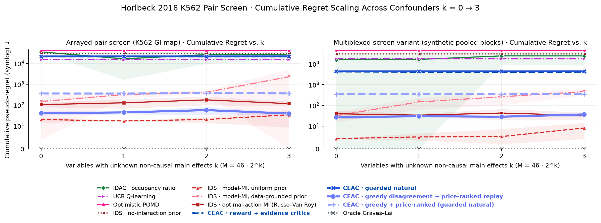
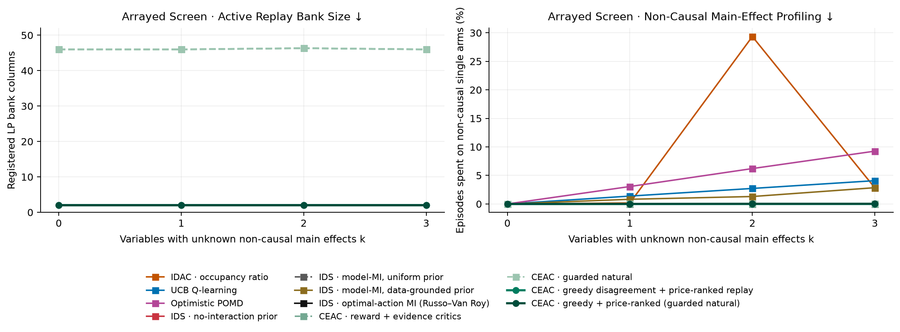
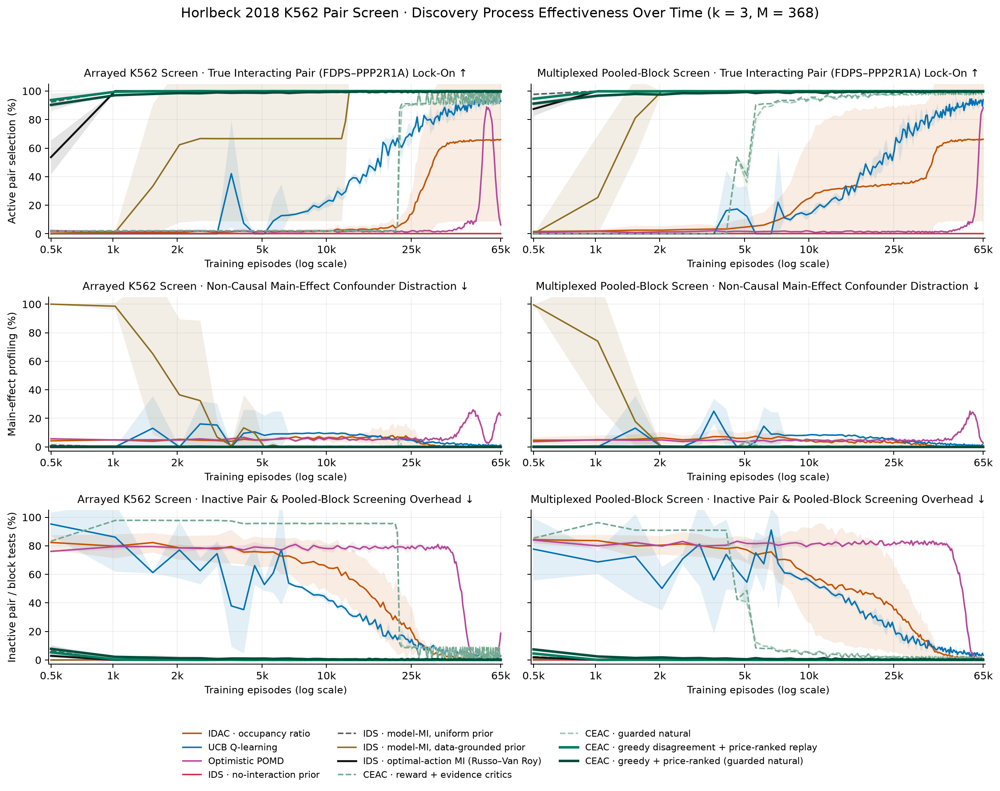
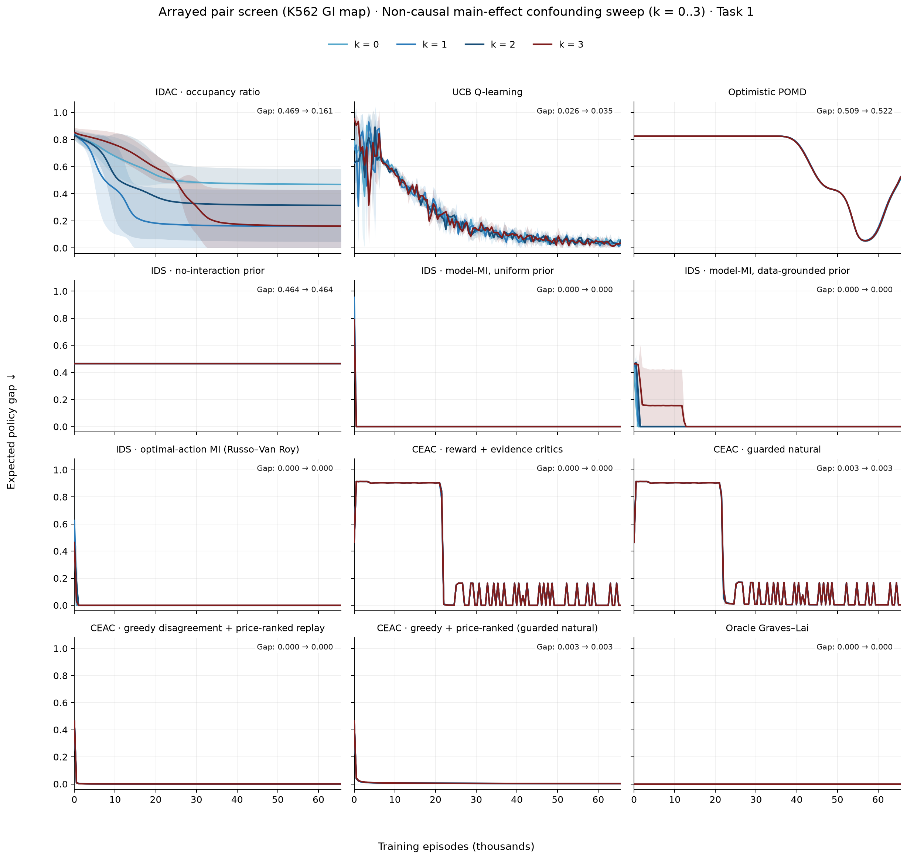
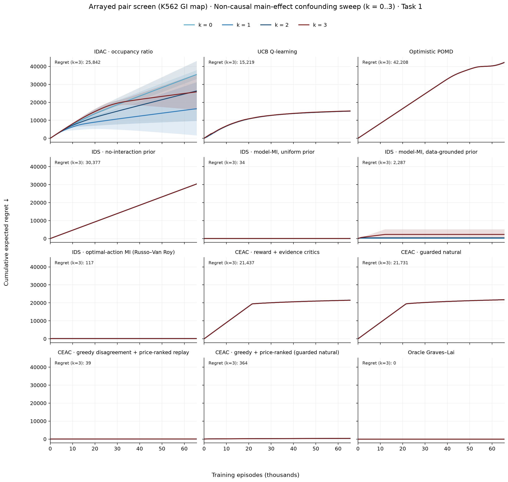
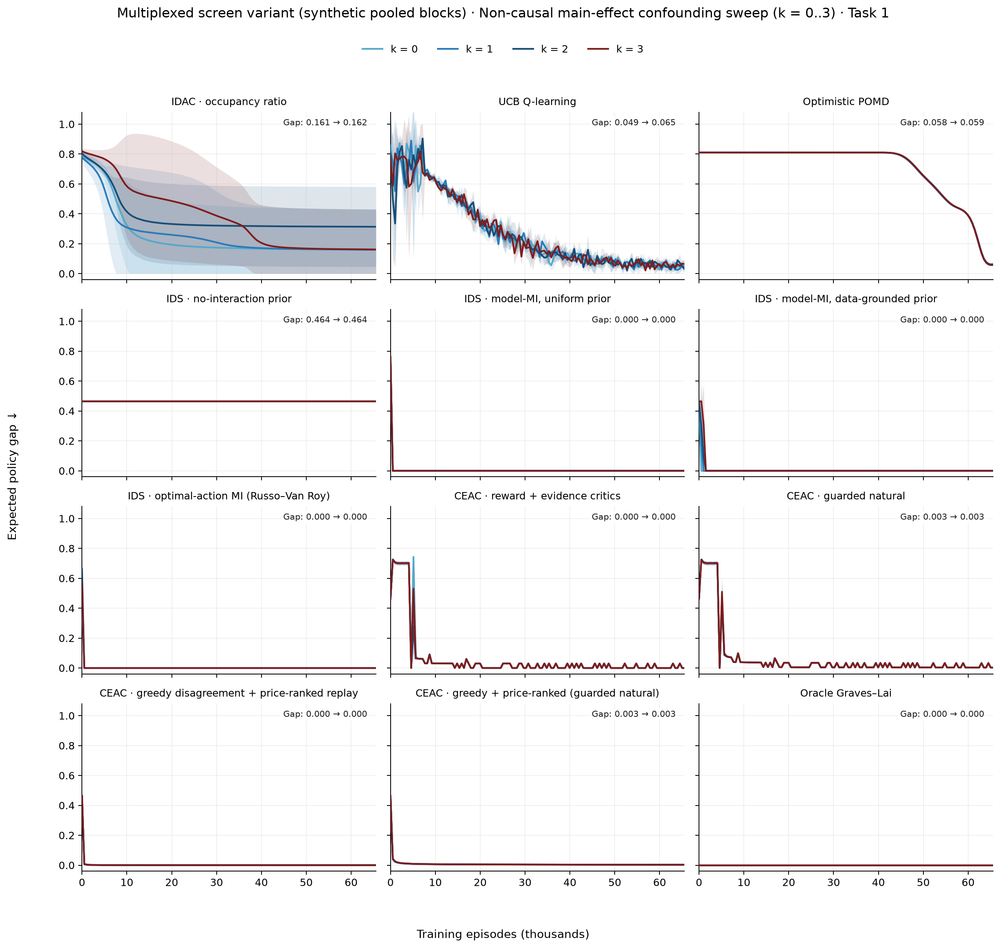
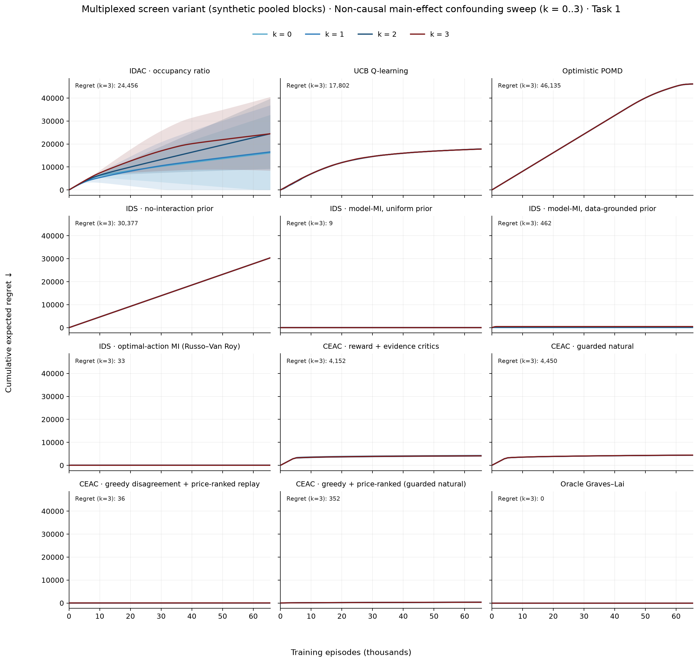

# Greedy Disagreement + Price-Ranked Replay CEAC on Horlbeck 2018 K562 Pair Screen

Verified **288** held-out sweep cells (`seeds = 0, 1, 2`, `65,536` episodes/cell) across `k = 0, 1, 2, 3` non-causal main-effect confounders.

> [!NOTE]
> `ceac_ranked` and `ceac_ranked_natural` are explicitly labeled heuristic extensions of Section-3 CEAC that replace uniform seed-bank replay floors with (1) coordinate-free greedy maximally-disagreeing column selection and (2) dynamic evidence-price ranking & KKT debt-modulated replay reuse.

## Headline Dose Response (`Task 1`, `k = 0 -> 3`)

## Mechanism Diagnostics (Active Bank Compression & Confounder Immunity)

## Visual Discovery-Process Time Traces (`k = 3`, `M = 368`)

## Per-Algorithm Performance Time Traces (`k = 0 .. 3`)

## Easy-Case Calibration Comparison (`dose = 0`, `seeds 1001, 1002`, Tasks 0 & 1)

| Screen Variant | Task | Algorithm | Active Bank Columns | Final Gap (mean) | Cumulative Regret (mean) |
|---|---:|---|---:|---:|---:|
| Arrayed pair screen (K562 GI map) | 0 | CEAC · reward + evidence critics | 46.0 | 0.3947 | 27,465.9 |
| Arrayed pair screen (K562 GI map) | 0 | CEAC · guarded natural | 46.0 | 0.3158 | 24,645.3 |
| Arrayed pair screen (K562 GI map) | 0 | CEAC · greedy disagreement + price-ranked replay | 46.0 | 0.0000 | 228.7 |
| Arrayed pair screen (K562 GI map) | 0 | CEAC · greedy + price-ranked (guarded natural) | 46.0 | 0.0013 | 380.0 |
| Arrayed pair screen (K562 GI map) | 0 | IDS · optimal-action MI (Russo–Van Roy) | — | 0.0000 | 45.3 |
| Arrayed pair screen (K562 GI map) | 0 | IDS · model-MI, data-grounded prior | — | 0.0000 | 48.7 |
| Arrayed pair screen (K562 GI map) | 1 | CEAC · reward + evidence critics | 46.0 | 0.0000 | 21,485.7 |
| Arrayed pair screen (K562 GI map) | 1 | CEAC · guarded natural | 46.0 | 0.0034 | 21,767.9 |
| Arrayed pair screen (K562 GI map) | 1 | CEAC · greedy disagreement + price-ranked replay | 2.0 | 0.0001 | 32.4 |
| Arrayed pair screen (K562 GI map) | 1 | CEAC · greedy + price-ranked (guarded natural) | 2.0 | 0.0027 | 347.4 |
| Arrayed pair screen (K562 GI map) | 1 | IDS · optimal-action MI (Russo–Van Roy) | — | 0.0000 | 11.0 |
| Arrayed pair screen (K562 GI map) | 1 | IDS · model-MI, data-grounded prior | — | 0.0000 | 40.3 |
| Multiplexed screen variant (synthetic pooled blocks) | 0 | CEAC · reward + evidence critics | 12.0 | 0.3915 | 24,860.1 |
| Multiplexed screen variant (synthetic pooled blocks) | 0 | CEAC · guarded natural | 11.5 | 0.4847 | 30,185.6 |
| Multiplexed screen variant (synthetic pooled blocks) | 0 | CEAC · greedy disagreement + price-ranked replay | 13.5 | 0.0000 | 74.3 |
| Multiplexed screen variant (synthetic pooled blocks) | 0 | CEAC · greedy + price-ranked (guarded natural) | 13.0 | 0.0012 | 209.4 |
| Multiplexed screen variant (synthetic pooled blocks) | 0 | IDS · optimal-action MI (Russo–Van Roy) | — | 0.0000 | 6.4 |
| Multiplexed screen variant (synthetic pooled blocks) | 0 | IDS · model-MI, data-grounded prior | — | 0.0000 | 8.3 |
| Multiplexed screen variant (synthetic pooled blocks) | 1 | CEAC · reward + evidence critics | 12.0 | 0.0000 | 4,132.0 |
| Multiplexed screen variant (synthetic pooled blocks) | 1 | CEAC · guarded natural | 12.0 | 0.0029 | 4,393.9 |
| Multiplexed screen variant (synthetic pooled blocks) | 1 | CEAC · greedy disagreement + price-ranked replay | 2.0 | 0.0000 | 25.6 |
| Multiplexed screen variant (synthetic pooled blocks) | 1 | CEAC · greedy + price-ranked (guarded natural) | 2.0 | 0.0028 | 337.7 |
| Multiplexed screen variant (synthetic pooled blocks) | 1 | IDS · optimal-action MI (Russo–Van Roy) | — | 0.0000 | 19.3 |
| Multiplexed screen variant (synthetic pooled blocks) | 1 | IDS · model-MI, data-grounded prior | — | 0.0000 | 22.5 |

## Held-Out Sweep Summary (`Task 1`, `k = 0 -> 3`, 65,536 Episodes)

| Screen Variant | Algorithm | Active Bank (k=3) | Final Gap (k=0 → k=3) | Regret (k=0 → k=3) | Main-Effect Profiling (k=3) |
|---|---|---:|---:|---:|---:|
| Arrayed pair screen (K562 GI map) | IDAC · occupancy ratio | — | 0.4690 → 0.1609 | 35,509.5 → 25,841.9 | 2.81% |
| Arrayed pair screen (K562 GI map) | UCB Q-learning | — | 0.0262 → 0.0349 | 15,172.5 → 15,219.0 | 4.08% |
| Arrayed pair screen (K562 GI map) | Optimistic POMD | — | 0.5095 → 0.5221 | 42,163.7 → 42,207.9 | 9.26% |
| Arrayed pair screen (K562 GI map) | IDS · no-interaction prior | — | 0.4635 → 0.4635 | 30,377.0 → 30,377.0 | 0.00% |
| Arrayed pair screen (K562 GI map) | IDS · model-MI, uniform prior | — | 0.0000 → 0.0000 | 20.2 → 34.2 | 0.01% |
| Arrayed pair screen (K562 GI map) | IDS · model-MI, data-grounded prior | — | 0.0000 → 0.0000 | 148.6 → 2,287.4 | 2.85% |
| Arrayed pair screen (K562 GI map) | IDS · optimal-action MI (Russo–Van Roy) | — | 0.0000 → 0.0000 | 105.3 → 117.2 | 0.00% |
| Arrayed pair screen (K562 GI map) | CEAC · reward + evidence critics | 46.0 | 0.0000 → 0.0001 | 21,495.8 → 21,437.0 | 0.02% |
| Arrayed pair screen (K562 GI map) | CEAC · guarded natural | 46.0 | 0.0034 → 0.0034 | 21,701.1 → 21,731.5 | 0.07% |
| Arrayed pair screen (K562 GI map) | CEAC · greedy disagreement + price-ranked replay | 2.0 | 0.0000 → 0.0000 | 40.7 → 39.2 | 0.00% |
| Arrayed pair screen (K562 GI map) | CEAC · greedy + price-ranked (guarded natural) | 2.0 | 0.0028 → 0.0028 | 360.5 → 363.6 | 0.03% |
| Arrayed pair screen (K562 GI map) | Oracle Graves–Lai | — | 0.0000 → 0.0000 | 0.0 → 0.0 | 0.00% |
| Multiplexed screen variant (synthetic pooled blocks) | IDAC · occupancy ratio | — | 0.1610 → 0.1617 | 16,127.9 → 24,456.0 | 2.20% |
| Multiplexed screen variant (synthetic pooled blocks) | UCB Q-learning | — | 0.0486 → 0.0645 | 17,824.7 → 17,802.1 | 4.00% |
| Multiplexed screen variant (synthetic pooled blocks) | Optimistic POMD | — | 0.0577 → 0.0586 | 46,072.9 → 46,135.1 | 7.34% |
| Multiplexed screen variant (synthetic pooled blocks) | IDS · no-interaction prior | — | 0.4635 → 0.4635 | 30,377.0 → 30,377.0 | 0.00% |
| Multiplexed screen variant (synthetic pooled blocks) | IDS · model-MI, uniform prior | — | 0.0000 → 0.0000 | 4.6 → 9.2 | 0.00% |
| Multiplexed screen variant (synthetic pooled blocks) | IDS · model-MI, data-grounded prior | — | 0.0000 → 0.0000 | 31.8 → 462.0 | 1.50% |
| Multiplexed screen variant (synthetic pooled blocks) | IDS · optimal-action MI (Russo–Van Roy) | — | 0.0000 → 0.0000 | 39.4 → 32.6 | 0.00% |
| Multiplexed screen variant (synthetic pooled blocks) | CEAC · reward + evidence critics | 12.0 | 0.0000 → 0.0000 | 4,284.0 → 4,152.1 | 0.03% |
| Multiplexed screen variant (synthetic pooled blocks) | CEAC · guarded natural | 12.0 | 0.0029 → 0.0029 | 4,426.7 → 4,450.2 | 0.07% |
| Multiplexed screen variant (synthetic pooled blocks) | CEAC · greedy disagreement + price-ranked replay | 2.0 | 0.0000 → 0.0000 | 26.8 → 36.5 | 0.00% |
| Multiplexed screen variant (synthetic pooled blocks) | CEAC · greedy + price-ranked (guarded natural) | 2.0 | 0.0028 → 0.0027 | 342.1 → 352.3 | 0.03% |
| Multiplexed screen variant (synthetic pooled blocks) | Oracle Graves–Lai | — | 0.0000 → 0.0000 | 0.0 → 0.0 | 0.00% |

## Paired Regret Saved by `ceac_ranked` at Maximum Confounding (`k = 3`, Task 1)

| Screen Variant | Comparator | Regret Saved vs `ceac_ranked` (mean ± SD) | `ceac_ranked` Lower on All Seeds |
|---|---|---:|---|
| Arrayed pair screen (K562 GI map) | IDAC · occupancy ratio | +25,802.8 ± 10,010.9 | True |
| Arrayed pair screen (K562 GI map) | UCB Q-learning | +15,179.9 ± 43.4 | True |
| Arrayed pair screen (K562 GI map) | Optimistic POMD | +42,168.7 ± 44.0 | True |
| Arrayed pair screen (K562 GI map) | IDS · no-interaction prior | +30,337.9 ± 5.1 | True |
| Arrayed pair screen (K562 GI map) | IDS · model-MI, uniform prior | -4.9 ± 29.0 | False |
| Arrayed pair screen (K562 GI map) | IDS · model-MI, data-grounded prior | +2,248.3 ± 2,906.2 | True |
| Arrayed pair screen (K562 GI map) | IDS · optimal-action MI (Russo–Van Roy) | +78.0 ± 32.1 | True |
| Arrayed pair screen (K562 GI map) | CEAC · reward + evidence critics | +21,397.8 ± 16.6 | True |
| Arrayed pair screen (K562 GI map) | CEAC · guarded natural | +21,692.3 ± 85.3 | True |
| Arrayed pair screen (K562 GI map) | CEAC · greedy + price-ranked (guarded natural) | +324.5 ± 5.5 | True |
| Arrayed pair screen (K562 GI map) | Oracle Graves–Lai | -39.2 ± 5.1 | False |
| Multiplexed screen variant (synthetic pooled blocks) | IDAC · occupancy ratio | +24,419.5 ± 16,031.8 | True |
| Multiplexed screen variant (synthetic pooled blocks) | UCB Q-learning | +17,765.6 ± 11.2 | True |
| Multiplexed screen variant (synthetic pooled blocks) | Optimistic POMD | +46,098.7 ± 62.0 | True |
| Multiplexed screen variant (synthetic pooled blocks) | IDS · no-interaction prior | +30,340.6 ± 9.3 | True |
| Multiplexed screen variant (synthetic pooled blocks) | IDS · model-MI, uniform prior | -27.3 ± 6.3 | False |
| Multiplexed screen variant (synthetic pooled blocks) | IDS · model-MI, data-grounded prior | +425.5 ± 161.3 | True |
| Multiplexed screen variant (synthetic pooled blocks) | IDS · optimal-action MI (Russo–Van Roy) | -3.9 ± 21.6 | False |
| Multiplexed screen variant (synthetic pooled blocks) | CEAC · reward + evidence critics | +4,115.6 ± 80.0 | True |
| Multiplexed screen variant (synthetic pooled blocks) | CEAC · guarded natural | +4,413.7 ± 74.7 | True |
| Multiplexed screen variant (synthetic pooled blocks) | CEAC · greedy + price-ranked (guarded natural) | +315.8 ± 11.2 | True |
| Multiplexed screen variant (synthetic pooled blocks) | Oracle Graves–Lai | -36.5 ± 9.3 | False |
