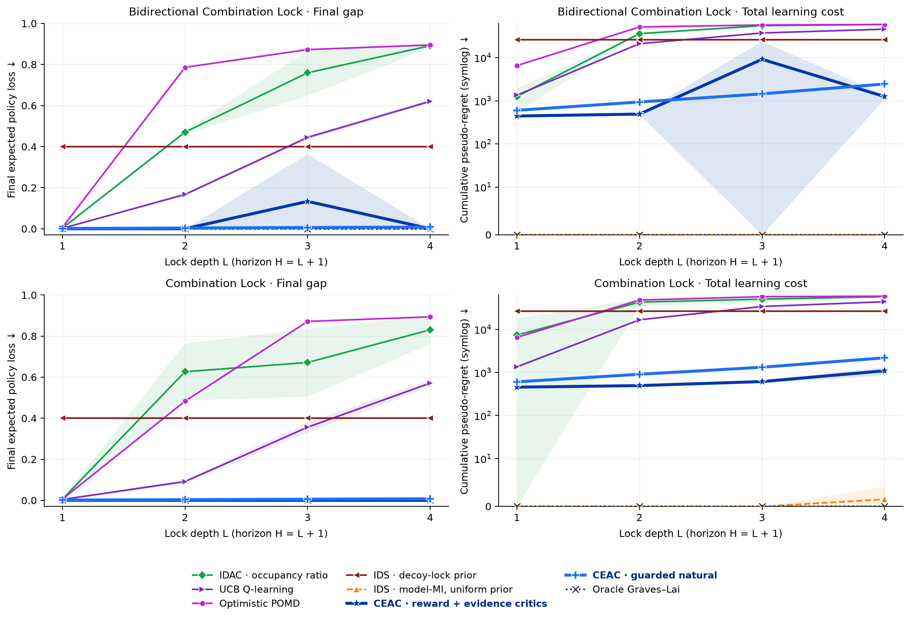
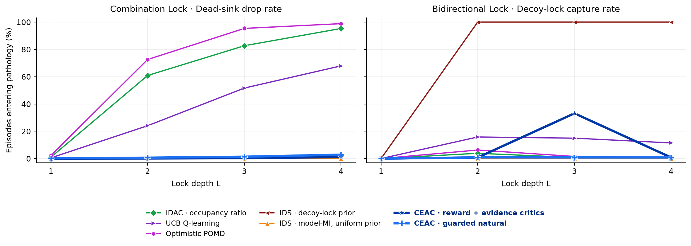
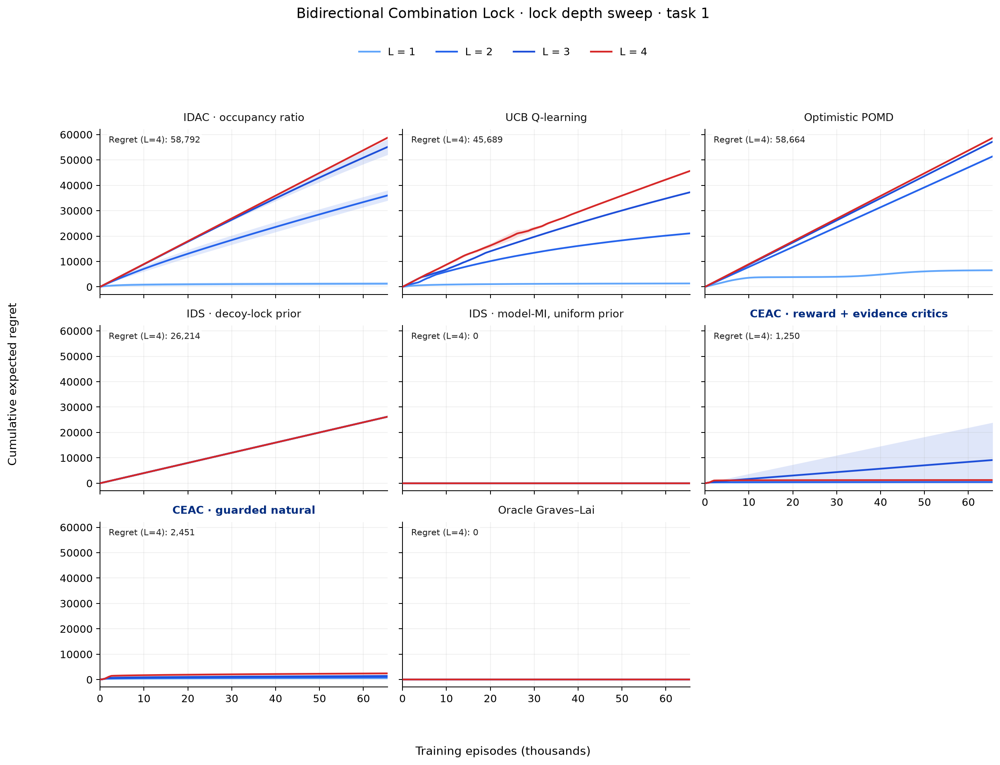
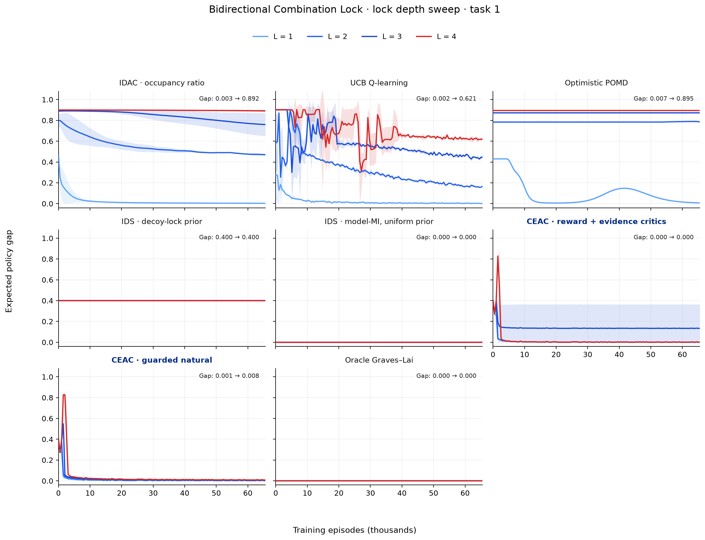
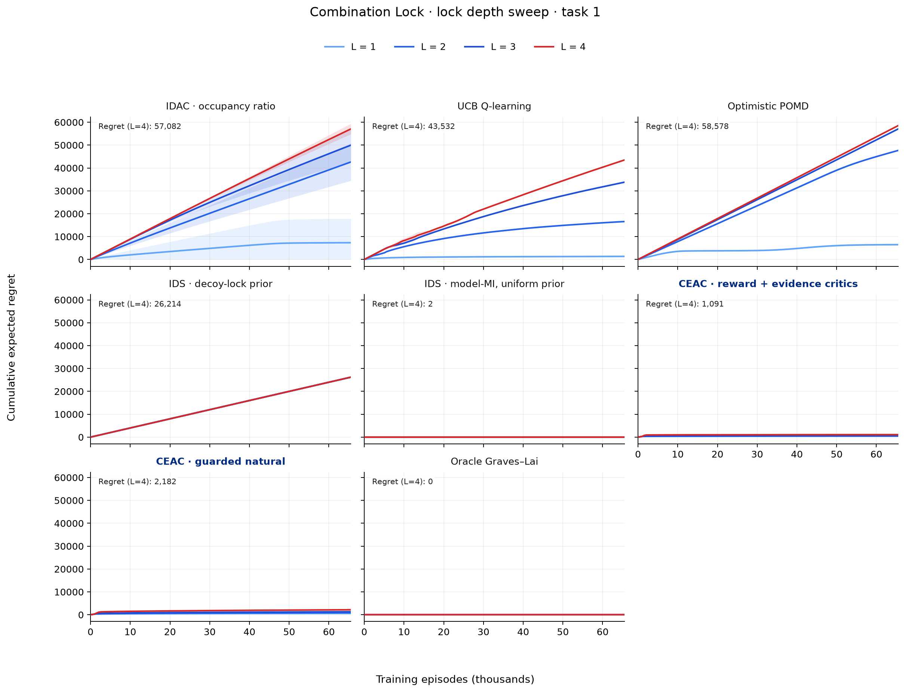
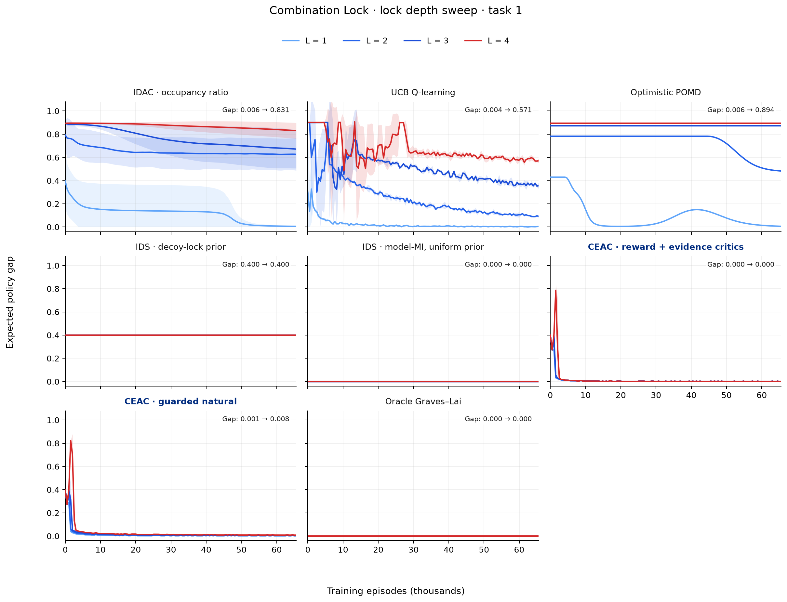

# Sequential Combination & Bidirectional Locks

Verified **192** completed cells (3 held-out seeds per condition, 65,536 episodes per run). Independent easy-case calibration passed before sweep execution.

## Headline Dose Response (Task 1)

## Mechanism Diagnostics

## Within-Algorithm Learning Fans

## Weakest-to-Strongest Pathology Summary (Task 1)

| Environment | Algorithm | Final gap: min → max | Regret: min → max | Primary distraction (max dose) |
|---|---|---:|---:|---:|
| Bidirectional Combination Lock | IDAC · occupancy ratio | 0.0031 → 0.8916 | 1,260.4 → 58,791.9 | sink 99.2% / decoy 0.4% |
| Bidirectional Combination Lock | UCB Q-learning | 0.0021 → 0.6208 | 1,346.7 → 45,688.7 | sink 69.6% / decoy 11.5% |
| Bidirectional Combination Lock | Optimistic POMD | 0.0067 → 0.8951 | 6,533.7 → 58,663.9 | sink 98.8% / decoy 0.4% |
| Bidirectional Combination Lock | IDS · decoy-lock prior | 0.4000 → 0.4000 | 26,214.4 → 26,214.4 | sink 0.0% / decoy 100.0% |
| Bidirectional Combination Lock | IDS · model-MI, uniform prior | 0.0000 → 0.0000 | 0.0 → 0.0 | sink 0.0% / decoy 0.0% |
| Bidirectional Combination Lock | CEAC · reward + evidence critics | 0.0000 → 0.0001 | 443.1 → 1,249.8 | sink 1.4% / decoy 0.8% |
| Bidirectional Combination Lock | CEAC · guarded natural | 0.0014 → 0.0083 | 600.2 → 2,450.9 | sink 3.3% / decoy 0.8% |
| Bidirectional Combination Lock | Oracle Graves–Lai | 0.0000 → 0.0000 | 0.0 → 0.0 | sink 0.0% / decoy 0.0% |
| Combination Lock | IDAC · occupancy ratio | 0.0059 → 0.8306 | 7,340.4 → 57,081.8 | sink 95.3% / decoy 0.0% |
| Combination Lock | UCB Q-learning | 0.0043 → 0.5708 | 1,347.8 → 43,532.3 | sink 67.9% / decoy 0.0% |
| Combination Lock | Optimistic POMD | 0.0062 → 0.8938 | 6,487.2 → 58,577.9 | sink 98.8% / decoy 0.0% |
| Combination Lock | IDS · decoy-lock prior | 0.4000 → 0.4000 | 26,214.4 → 26,214.4 | sink 0.0% / decoy 0.0% |
| Combination Lock | IDS · model-MI, uniform prior | 0.0000 → 0.0000 | 0.0 → 1.5 | sink 0.0% / decoy 0.0% |
| Combination Lock | CEAC · reward + evidence critics | 0.0000 → 0.0001 | 454.6 → 1,090.8 | sink 1.1% / decoy 0.0% |
| Combination Lock | CEAC · guarded natural | 0.0014 → 0.0079 | 603.7 → 2,182.3 | sink 2.9% / decoy 0.0% |
| Combination Lock | Oracle Graves–Lai | 0.0000 → 0.0000 | 0.0 → 0.0 | sink 0.0% / decoy 0.0% |

## Paired CEAC Advantage at Maximum Pathology (Dose = 4, Task 1)

| Environment | Comparator | Regret saved vs CEAC (mean ± SD) | Added advantage over min dose | CEAC lower on all seeds |
|---|---|---:|---:|---|
| Bidirectional Combination Lock | IDAC · occupancy ratio | +57,542.1 ± 220.6 | +56,724.8 ± 492.5 | True |
| Bidirectional Combination Lock | UCB Q-learning | +44,439.0 ± 31.4 | +43,535.4 ± 46.9 | True |
| Bidirectional Combination Lock | Optimistic POMD | +57,414.2 ± 135.6 | +51,323.6 ± 116.5 | True |
| Bidirectional Combination Lock | IDS · decoy-lock prior | +24,964.6 ± 135.6 | -806.7 ± 143.9 | True |
| Bidirectional Combination Lock | IDS · model-MI, uniform prior | -1,249.8 ± 135.6 | -806.7 ± 143.9 | False |
| Bidirectional Combination Lock | CEAC · guarded natural | +1,201.2 ± 268.0 | +1,044.1 ± 269.3 | True |
| Bidirectional Combination Lock | Oracle Graves–Lai | -1,249.8 ± 135.6 | -806.7 ± 143.9 | False |
| Combination Lock | IDAC · occupancy ratio | +55,991.0 ± 2,169.6 | +49,105.2 ± 12,589.5 | True |
| Combination Lock | UCB Q-learning | +42,441.5 ± 337.2 | +41,548.3 ± 392.5 | True |
| Combination Lock | Optimistic POMD | +57,487.1 ± 232.2 | +51,454.5 ± 223.9 | True |
| Combination Lock | IDS · decoy-lock prior | +25,123.6 ± 232.2 | -636.2 ± 236.2 | True |
| Combination Lock | IDS · model-MI, uniform prior | -1,089.3 ± 234.2 | -634.7 ± 237.9 | False |
| Combination Lock | CEAC · guarded natural | +1,091.5 ± 367.8 | +942.4 ± 377.7 | True |
| Combination Lock | Oracle Graves–Lai | -1,090.8 ± 232.2 | -636.2 ± 236.2 | False |

## Complete Endpoint Table

| Environment | Task | Algorithm | Dose | Final gap (mean ± SD) | Cumulative regret (mean ± SD) |
|---|---:|---|---:|---:|---:|
| Bidirectional Combination Lock | 1 | CEAC · reward + evidence critics | 1 | 0.0000 ± 0.0000 | 443.1 ± 8.3 |
| Bidirectional Combination Lock | 1 | CEAC · reward + evidence critics | 2 | 0.0001 ± 0.0000 | 491.4 ± 11.2 |
| Bidirectional Combination Lock | 1 | CEAC · reward + evidence critics | 3 | 0.1334 ± 0.2309 | 9,138.2 ± 14,761.5 |
| Bidirectional Combination Lock | 1 | CEAC · reward + evidence critics | 4 | 0.0001 ± 0.0000 | 1,249.8 ± 135.6 |
| Bidirectional Combination Lock | 1 | CEAC · guarded natural | 1 | 0.0014 ± 0.0000 | 600.2 ± 6.4 |
| Bidirectional Combination Lock | 1 | CEAC · guarded natural | 2 | 0.0037 ± 0.0000 | 936.0 ± 11.2 |
| Bidirectional Combination Lock | 1 | CEAC · guarded natural | 3 | 0.0060 ± 0.0000 | 1,444.5 ± 53.3 |
| Bidirectional Combination Lock | 1 | CEAC · guarded natural | 4 | 0.0083 ± 0.0000 | 2,450.9 ± 146.8 |
| Bidirectional Combination Lock | 1 | IDAC · occupancy ratio | 1 | 0.0031 ± 0.0001 | 1,260.4 ± 706.1 |
| Bidirectional Combination Lock | 1 | IDAC · occupancy ratio | 2 | 0.4705 ± 0.0104 | 36,024.1 ± 2,030.1 |
| Bidirectional Combination Lock | 1 | IDAC · occupancy ratio | 3 | 0.7596 ± 0.1107 | 55,131.4 ± 3,082.2 |
| Bidirectional Combination Lock | 1 | IDAC · occupancy ratio | 4 | 0.8916 ± 0.0100 | 58,791.9 ± 331.8 |
| Bidirectional Combination Lock | 1 | IDS · decoy-lock prior | 1 | 0.4000 ± 0.0000 | 26,214.4 ± 0.0 |
| Bidirectional Combination Lock | 1 | IDS · decoy-lock prior | 2 | 0.4000 ± 0.0000 | 26,214.4 ± 0.0 |
| Bidirectional Combination Lock | 1 | IDS · decoy-lock prior | 3 | 0.4000 ± 0.0000 | 26,214.4 ± 0.0 |
| Bidirectional Combination Lock | 1 | IDS · decoy-lock prior | 4 | 0.4000 ± 0.0000 | 26,214.4 ± 0.0 |
| Bidirectional Combination Lock | 1 | IDS · model-MI, uniform prior | 1 | 0.0000 ± 0.0000 | 0.0 ± 0.0 |
| Bidirectional Combination Lock | 1 | IDS · model-MI, uniform prior | 2 | 0.0000 ± 0.0000 | 0.0 ± 0.0 |
| Bidirectional Combination Lock | 1 | IDS · model-MI, uniform prior | 3 | 0.0000 ± 0.0000 | 0.0 ± 0.0 |
| Bidirectional Combination Lock | 1 | IDS · model-MI, uniform prior | 4 | 0.0000 ± 0.0000 | 0.0 ± 0.0 |
| Bidirectional Combination Lock | 1 | Oracle Graves–Lai | 1 | 0.0000 ± 0.0000 | 0.0 ± 0.0 |
| Bidirectional Combination Lock | 1 | Oracle Graves–Lai | 2 | 0.0000 ± 0.0000 | 0.0 ± 0.0 |
| Bidirectional Combination Lock | 1 | Oracle Graves–Lai | 3 | 0.0000 ± 0.0000 | 0.0 ± 0.0 |
| Bidirectional Combination Lock | 1 | Oracle Graves–Lai | 4 | 0.0000 ± 0.0000 | 0.0 ± 0.0 |
| Bidirectional Combination Lock | 1 | Optimistic POMD | 1 | 0.0067 ± 0.0009 | 6,533.7 ± 42.7 |
| Bidirectional Combination Lock | 1 | Optimistic POMD | 2 | 0.7860 ± 0.0031 | 51,409.9 ± 31.5 |
| Bidirectional Combination Lock | 1 | Optimistic POMD | 3 | 0.8728 ± 0.0000 | 57,196.5 ± 0.0 |
| Bidirectional Combination Lock | 1 | Optimistic POMD | 4 | 0.8951 ± 0.0000 | 58,663.9 ± 0.0 |
| Bidirectional Combination Lock | 1 | UCB Q-learning | 1 | 0.0021 ± 0.0009 | 1,346.7 ± 52.9 |
| Bidirectional Combination Lock | 1 | UCB Q-learning | 2 | 0.1673 ± 0.0060 | 21,082.7 ± 56.0 |
| Bidirectional Combination Lock | 1 | UCB Q-learning | 3 | 0.4449 ± 0.0107 | 37,282.1 ± 135.4 |
| Bidirectional Combination Lock | 1 | UCB Q-learning | 4 | 0.6208 ± 0.0074 | 45,688.7 ± 160.9 |
| Combination Lock | 1 | CEAC · reward + evidence critics | 1 | 0.0000 ± 0.0000 | 454.6 ± 21.7 |
| Combination Lock | 1 | CEAC · reward + evidence critics | 2 | 0.0001 ± 0.0000 | 494.5 ± 13.0 |
| Combination Lock | 1 | CEAC · reward + evidence critics | 3 | 0.0001 ± 0.0000 | 613.2 ± 49.5 |
| Combination Lock | 1 | CEAC · reward + evidence critics | 4 | 0.0001 ± 0.0000 | 1,090.8 ± 232.2 |
| Combination Lock | 1 | CEAC · guarded natural | 1 | 0.0014 ± 0.0000 | 603.7 ± 6.4 |
| Combination Lock | 1 | CEAC · guarded natural | 2 | 0.0035 ± 0.0000 | 905.3 ± 21.6 |
| Combination Lock | 1 | CEAC · guarded natural | 3 | 0.0057 ± 0.0000 | 1,316.4 ± 76.8 |
| Combination Lock | 1 | CEAC · guarded natural | 4 | 0.0079 ± 0.0000 | 2,182.3 ± 151.0 |
| Combination Lock | 1 | IDAC · occupancy ratio | 1 | 0.0059 ± 0.0049 | 7,340.4 ± 10,509.2 |
| Combination Lock | 1 | IDAC · occupancy ratio | 2 | 0.6264 ± 0.1389 | 42,643.1 ± 8,176.1 |
| Combination Lock | 1 | IDAC · occupancy ratio | 3 | 0.6715 ± 0.1655 | 49,985.5 ± 7,468.0 |
| Combination Lock | 1 | IDAC · occupancy ratio | 4 | 0.8306 ± 0.0683 | 57,081.8 ± 2,277.4 |
| Combination Lock | 1 | IDS · decoy-lock prior | 1 | 0.4000 ± 0.0000 | 26,214.4 ± 0.0 |
| Combination Lock | 1 | IDS · decoy-lock prior | 2 | 0.4000 ± 0.0000 | 26,214.4 ± 0.0 |
| Combination Lock | 1 | IDS · decoy-lock prior | 3 | 0.4000 ± 0.0000 | 26,214.4 ± 0.0 |
| Combination Lock | 1 | IDS · decoy-lock prior | 4 | 0.4000 ± 0.0000 | 26,214.4 ± 0.0 |
| Combination Lock | 1 | IDS · model-MI, uniform prior | 1 | 0.0000 ± 0.0000 | 0.0 ± 0.0 |
| Combination Lock | 1 | IDS · model-MI, uniform prior | 2 | 0.0000 ± 0.0000 | 0.0 ± 0.0 |
| Combination Lock | 1 | IDS · model-MI, uniform prior | 3 | 0.0000 ± 0.0000 | 0.0 ± 0.0 |
| Combination Lock | 1 | IDS · model-MI, uniform prior | 4 | 0.0000 ± 0.0000 | 1.5 ± 2.6 |
| Combination Lock | 1 | Oracle Graves–Lai | 1 | 0.0000 ± 0.0000 | 0.0 ± 0.0 |
| Combination Lock | 1 | Oracle Graves–Lai | 2 | 0.0000 ± 0.0000 | 0.0 ± 0.0 |
| Combination Lock | 1 | Oracle Graves–Lai | 3 | 0.0000 ± 0.0000 | 0.0 ± 0.0 |
| Combination Lock | 1 | Oracle Graves–Lai | 4 | 0.0000 ± 0.0000 | 0.0 ± 0.0 |
| Combination Lock | 1 | Optimistic POMD | 1 | 0.0062 ± 0.0004 | 6,487.2 ± 34.5 |
| Combination Lock | 1 | Optimistic POMD | 2 | 0.4830 ± 0.0021 | 47,700.2 ± 80.5 |
| Combination Lock | 1 | Optimistic POMD | 3 | 0.8715 ± 0.0000 | 57,114.6 ± 0.0 |
| Combination Lock | 1 | Optimistic POMD | 4 | 0.8938 ± 0.0000 | 58,577.9 ± 0.0 |
| Combination Lock | 1 | UCB Q-learning | 1 | 0.0043 ± 0.0035 | 1,347.8 ± 101.4 |
| Combination Lock | 1 | UCB Q-learning | 2 | 0.0916 ± 0.0093 | 16,593.2 ± 49.7 |
| Combination Lock | 1 | UCB Q-learning | 3 | 0.3563 ± 0.0251 | 33,801.9 ± 102.6 |
| Combination Lock | 1 | UCB Q-learning | 4 | 0.5708 ± 0.0166 | 43,532.3 ± 266.0 |
