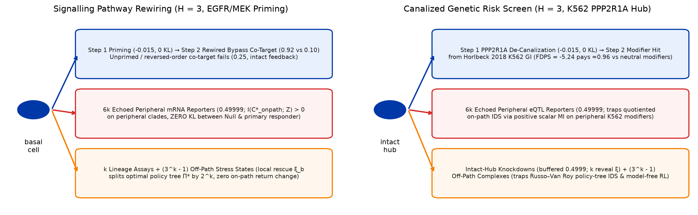
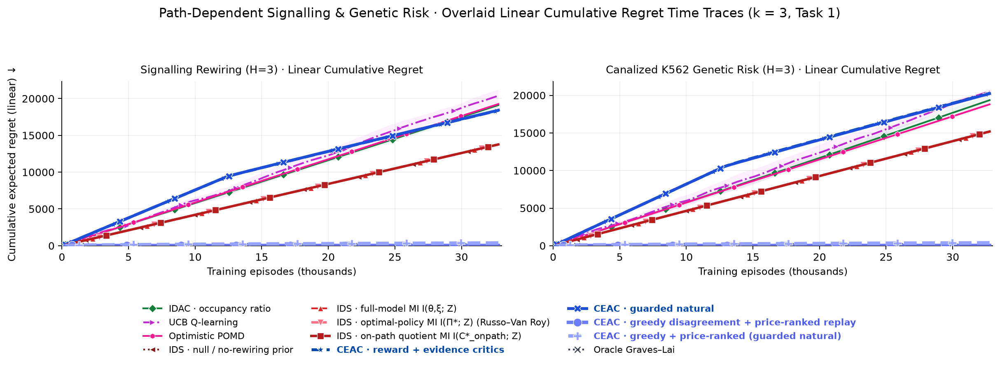
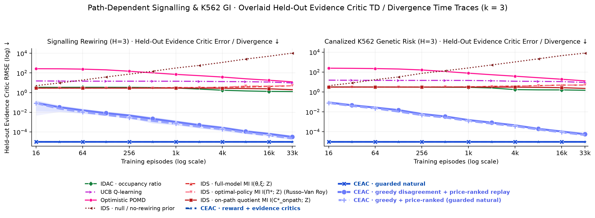
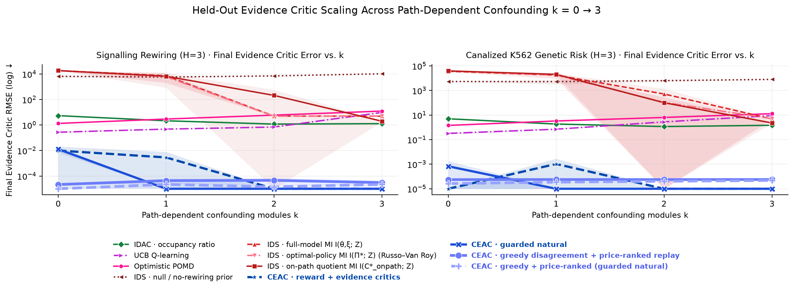

# Path-Dependent Signalling Rewiring & Canalized K562 Genetic Risk (`ceac_pathdep`)

Verified **288** held-out sweep cells (`seeds = 0, 1, 2`, `32,768` episodes / `98,304` physical steps per cell) plus **56** easy-case calibration cells (`k = 0`, `seeds 1001, 1002`, `Tasks 0 & 1`).

## Why CEAC Separates from Both Optimal-Policy MI `I(Π*; Z)` and On-Path Quotient MI `I(C*_onpath; Z)`

- **`ids_action_tree` (`I(Π*; Z)`, Russo–Van Roy MDP optimal-policy MI)**: Off-path stress/non-hub states carry local rescue rules governed by latent modifiers `ξ ∈ {0, 1}^k`, splitting `Π*(θ, ξ)` by `2^k` and trapping policy-tree IDS into profiling non-causal modifier assays (`0%` on-path return impact).
- **`ids_action_onpath` (`I(C*_onpath; Z)`, quotiented on-path class MI)**: Even after manually gifting IDS CEAC's on-path return quotient, scalar mutual information rewards cheap peripheral clade/eQTL reporters (`0.49998` return) that reduce tail entropy on peripheral candidates while providing **zero KL** between `Null` and the realized responder.
- **`ceac_ranked` & `ceac`**: Track vector-valued pairwise log-likelihood ratios across undefeated on-path alternatives and propagate dual evidence prices `β` across the `-0.015` Step-1 priming / `PPP2R1A` hub-decanalization gate via `Q_I(s, a; β)`.

## Architecture

## Dose Response Across Path-Dependent Complexity (`k = 0 -> 3`)

## Overlaid Performance & Discovery Time Traces (`k = 3`)

## Held-Out Sweep Summary (`Task 1`, `k = 0 -> 3`)

| Benchmark | Algorithm | Bank (k=3) | Final Gap (k=0 → k=3) | Regret (k=0 → k=3) | Echo% (k=3) | OffPath-Mod% (k=3) |
|---|---|---:|---:|---:|---:|---:|
| Path-Dependent Signalling Rewiring (EGFR/MEK Priming, H = 3) | IDAC · occupancy ratio | — | 0.5118 → 0.5885 | 17,496.6 → 19,114.0 | 35.94% | 6.85% |
| Path-Dependent Signalling Rewiring (EGFR/MEK Priming, H = 3) | UCB Q-learning | — | 0.1575 → 0.6150 | 9,863.7 → 20,389.4 | 25.04% | 5.58% |
| Path-Dependent Signalling Rewiring (EGFR/MEK Priming, H = 3) | Optimistic POMD | — | 0.6576 → 0.5878 | 19,308.1 → 19,260.1 | 36.00% | 5.96% |
| Path-Dependent Signalling Rewiring (EGFR/MEK Priming, H = 3) | IDS · null / no-rewiring prior | — | 0.4200 → 0.4200 | 13,762.6 → 13,762.6 | 0.00% | 0.00% |
| Path-Dependent Signalling Rewiring (EGFR/MEK Priming, H = 3) | IDS · full-model MI I(θ,ξ; Z) | — | 0.0000 → 0.4203 | 232.1 → 13,765.3 | 79.00% | 20.97% |
| Path-Dependent Signalling Rewiring (EGFR/MEK Priming, H = 3) | IDS · optimal-policy MI I(Π*; Z) (Russo–Van Roy) | — | 0.0000 → 0.4203 | 312.8 → 13,764.6 | 85.68% | 14.30% |
| Path-Dependent Signalling Rewiring (EGFR/MEK Priming, H = 3) | IDS · on-path quotient MI I(C*_onpath; Z) | — | 0.0000 → 0.4200 | 278.9 → 13,762.9 | 100.00% | 0.00% |
| Path-Dependent Signalling Rewiring (EGFR/MEK Priming, H = 3) | CEAC · reward + evidence critics | 28.0 | 0.1613 → 0.4570 | 10,162.3 → 18,390.7 | 0.32% | 38.60% |
| Path-Dependent Signalling Rewiring (EGFR/MEK Priming, H = 3) | CEAC · guarded natural | 28.0 | 0.0314 → 0.4579 | 3,818.3 → 18,421.0 | 7.38% | 37.07% |
| Path-Dependent Signalling Rewiring (EGFR/MEK Priming, H = 3) | CEAC · greedy disagreement + price-ranked replay | 2.0 | 0.0001 → 0.0001 | 35.7 → 40.0 | 0.03% | 0.01% |
| Path-Dependent Signalling Rewiring (EGFR/MEK Priming, H = 3) | CEAC · greedy + price-ranked (guarded natural) | 2.0 | 0.0045 → 0.0063 | 253.4 → 372.8 | 0.30% | 0.05% |
| Path-Dependent Signalling Rewiring (EGFR/MEK Priming, H = 3) | Oracle Graves–Lai | — | 0.0000 → 0.0000 | 0.0 → 0.0 | 0.00% | 0.00% |
| Canalized Genetic Risk Screen (K562 PPP2R1A Hub, H = 3) | IDAC · occupancy ratio | — | 0.4649 → 0.6066 | 16,060.0 → 19,356.8 | 21.81% | 2.56% |
| Canalized Genetic Risk Screen (K562 PPP2R1A Hub, H = 3) | UCB Q-learning | — | 0.2690 → 0.5635 | 13,144.8 → 20,523.0 | 26.84% | 2.47% |
| Canalized Genetic Risk Screen (K562 PPP2R1A Hub, H = 3) | Optimistic POMD | — | 0.4917 → 0.5738 | 16,111.1 → 18,800.8 | 24.29% | 3.98% |
| Canalized Genetic Risk Screen (K562 PPP2R1A Hub, H = 3) | IDS · null / no-rewiring prior | — | 0.4635 → 0.4635 | 15,188.5 → 15,188.5 | 0.00% | 0.00% |
| Canalized Genetic Risk Screen (K562 PPP2R1A Hub, H = 3) | IDS · full-model MI I(θ,ξ; Z) | — | 0.0000 → 0.4635 | 1,344.2 → 15,190.8 | 79.43% | 20.55% |
| Canalized Genetic Risk Screen (K562 PPP2R1A Hub, H = 3) | IDS · optimal-policy MI I(Π*; Z) (Russo–Van Roy) | — | 0.0000 → 0.4639 | 393.2 → 15,191.0 | 87.58% | 12.40% |
| Canalized Genetic Risk Screen (K562 PPP2R1A Hub, H = 3) | IDS · on-path quotient MI I(C*_onpath; Z) | — | 0.0000 → 0.4635 | 279.7 → 15,189.0 | 100.00% | 0.00% |
| Canalized Genetic Risk Screen (K562 PPP2R1A Hub, H = 3) | CEAC · reward + evidence critics | 29.0 | 0.4780 → 0.5040 | 16,989.0 → 20,279.5 | 0.71% | 0.90% |
| Canalized Genetic Risk Screen (K562 PPP2R1A Hub, H = 3) | CEAC · guarded natural | 29.0 | 0.4781 → 0.5046 | 16,987.5 → 20,232.4 | 0.26% | 4.57% |
| Canalized Genetic Risk Screen (K562 PPP2R1A Hub, H = 3) | CEAC · greedy disagreement + price-ranked replay | 2.0 | 0.0001 → 0.0001 | 39.8 → 37.2 | 0.02% | 0.00% |
| Canalized Genetic Risk Screen (K562 PPP2R1A Hub, H = 3) | CEAC · greedy + price-ranked (guarded natural) | 2.0 | 0.0053 → 0.0065 | 298.9 → 390.2 | 0.23% | 0.04% |
| Canalized Genetic Risk Screen (K562 PPP2R1A Hub, H = 3) | Oracle Graves–Lai | — | 0.0000 → 0.0000 | 0.0 → 0.0 | 0.00% | 0.00% |

## Paired Regret Saved by `ceac_ranked` at `k = 3` (`Task 1`)

| Benchmark | Comparator | Regret Saved vs `ceac_ranked` (mean ± SD) | `ceac_ranked` Lower on All Seeds |
|---|---|---:|---|
| Path-Dependent Signalling Rewiring (EGFR/MEK Priming, H = 3) | IDAC · occupancy ratio | +19,074.0 ± 348.1 | True |
| Path-Dependent Signalling Rewiring (EGFR/MEK Priming, H = 3) | UCB Q-learning | +20,349.4 ± 852.7 | True |
| Path-Dependent Signalling Rewiring (EGFR/MEK Priming, H = 3) | Optimistic POMD | +19,220.1 ± 2.6 | True |
| Path-Dependent Signalling Rewiring (EGFR/MEK Priming, H = 3) | IDS · null / no-rewiring prior | +13,722.6 ± 2.6 | True |
| Path-Dependent Signalling Rewiring (EGFR/MEK Priming, H = 3) | IDS · full-model MI I(θ,ξ; Z) | +13,725.3 ± 2.4 | True |
| Path-Dependent Signalling Rewiring (EGFR/MEK Priming, H = 3) | IDS · optimal-policy MI I(Π*; Z) (Russo–Van Roy) | +13,724.6 ± 2.9 | True |
| Path-Dependent Signalling Rewiring (EGFR/MEK Priming, H = 3) | IDS · on-path quotient MI I(C*_onpath; Z) | +13,722.9 ± 2.6 | True |
| Path-Dependent Signalling Rewiring (EGFR/MEK Priming, H = 3) | CEAC · reward + evidence critics | +18,350.7 ± 14.4 | True |
| Path-Dependent Signalling Rewiring (EGFR/MEK Priming, H = 3) | CEAC · guarded natural | +18,381.0 ± 5.6 | True |
| Path-Dependent Signalling Rewiring (EGFR/MEK Priming, H = 3) | CEAC · greedy + price-ranked (guarded natural) | +332.8 ± 4.5 | True |
| Path-Dependent Signalling Rewiring (EGFR/MEK Priming, H = 3) | Oracle Graves–Lai | -40.0 ± 2.6 | False |
| Canalized Genetic Risk Screen (K562 PPP2R1A Hub, H = 3) | IDAC · occupancy ratio | +19,319.6 ± 744.5 | True |
| Canalized Genetic Risk Screen (K562 PPP2R1A Hub, H = 3) | UCB Q-learning | +20,485.9 ± 267.5 | True |
| Canalized Genetic Risk Screen (K562 PPP2R1A Hub, H = 3) | Optimistic POMD | +18,763.7 ± 4.7 | True |
| Canalized Genetic Risk Screen (K562 PPP2R1A Hub, H = 3) | IDS · null / no-rewiring prior | +15,151.4 ± 4.7 | True |
| Canalized Genetic Risk Screen (K562 PPP2R1A Hub, H = 3) | IDS · full-model MI I(θ,ξ; Z) | +15,153.6 ± 4.7 | True |
| Canalized Genetic Risk Screen (K562 PPP2R1A Hub, H = 3) | IDS · optimal-policy MI I(Π*; Z) (Russo–Van Roy) | +15,153.8 ± 4.9 | True |
| Canalized Genetic Risk Screen (K562 PPP2R1A Hub, H = 3) | IDS · on-path quotient MI I(C*_onpath; Z) | +15,151.8 ± 4.6 | True |
| Canalized Genetic Risk Screen (K562 PPP2R1A Hub, H = 3) | CEAC · reward + evidence critics | +20,242.3 ± 15.7 | True |
| Canalized Genetic Risk Screen (K562 PPP2R1A Hub, H = 3) | CEAC · guarded natural | +20,195.3 ± 8.6 | True |
| Canalized Genetic Risk Screen (K562 PPP2R1A Hub, H = 3) | CEAC · greedy + price-ranked (guarded natural) | +353.0 ± 11.7 | True |
| Canalized Genetic Risk Screen (K562 PPP2R1A Hub, H = 3) | Oracle Graves–Lai | -37.2 ± 4.7 | False |

## Held-Out Reward & Evidence Critic TD / Bellman Error Audit

Evaluated at 12 log-spaced checkpoints (`t = 16 .. 32,768`) on **512 independent held-out evaluation rollouts** per checkpoint (`256` on-policy + `256` exploratory DAG-probe rollouts in an isolated `eval_env` with zero training-state mutation; bit-for-bit cumulative regret parity verified against the registered sweep).

| Benchmark (`k = 3`, `t = 32,768`) | Algorithm | Held-Out Reward Bellman RMSE | Native Evidence Critic RMSE | Bounded Stage-Epistemic RMSE |
|---|---|---:|---:|---:|
| Path-Dependent Signalling Rewiring (EGFR/MEK Priming, H = 3) | IDAC · occupancy ratio | 0.1644 | 1.2824 | 1.2824 |
| Path-Dependent Signalling Rewiring (EGFR/MEK Priming, H = 3) | UCB Q-learning | 5.4713 | 9.6897 | 9.6897 |
| Path-Dependent Signalling Rewiring (EGFR/MEK Priming, H = 3) | Optimistic POMD | 0.9243 | 12.3881 | 12.3881 |
| Path-Dependent Signalling Rewiring (EGFR/MEK Priming, H = 3) | IDS · null / no-rewiring prior | 0.0256 | 10,437.7742 | 0.3382 |
| Path-Dependent Signalling Rewiring (EGFR/MEK Priming, H = 3) | IDS · full-model MI I(θ,ξ; Z) | 0.0156 | 4.9497 | 0.0078 |
| Path-Dependent Signalling Rewiring (EGFR/MEK Priming, H = 3) | IDS · optimal-policy MI I(Π*; Z) (Russo–Van Roy) | 0.0154 | 5.1106 | 0.0060 |
| Path-Dependent Signalling Rewiring (EGFR/MEK Priming, H = 3) | IDS · on-path quotient MI I(C*_onpath; Z) | 0.0155 | 1.9894 | 0.2939 |
| Path-Dependent Signalling Rewiring (EGFR/MEK Priming, H = 3) | CEAC · reward + evidence critics | 0.0009 | 0.0000 | 0.0000 |
| Path-Dependent Signalling Rewiring (EGFR/MEK Priming, H = 3) | CEAC · guarded natural | 0.0033 | 0.0000 | 0.0000 |
| Path-Dependent Signalling Rewiring (EGFR/MEK Priming, H = 3) | CEAC · greedy disagreement + price-ranked replay | 0.0409 | 0.0000 | 0.0000 |
| Path-Dependent Signalling Rewiring (EGFR/MEK Priming, H = 3) | CEAC · greedy + price-ranked (guarded natural) | 0.0273 | 0.0000 | 0.0000 |
| Canalized Genetic Risk Screen (K562 PPP2R1A Hub, H = 3) | IDAC · occupancy ratio | 0.1532 | 1.4778 | 1.4778 |
| Canalized Genetic Risk Screen (K562 PPP2R1A Hub, H = 3) | UCB Q-learning | 5.7499 | 9.0508 | 9.0508 |
| Canalized Genetic Risk Screen (K562 PPP2R1A Hub, H = 3) | Optimistic POMD | 0.9121 | 12.9965 | 12.9965 |
| Canalized Genetic Risk Screen (K562 PPP2R1A Hub, H = 3) | IDS · null / no-rewiring prior | 0.0102 | 8,013.5050 | 0.2623 |
| Canalized Genetic Risk Screen (K562 PPP2R1A Hub, H = 3) | IDS · full-model MI I(θ,ξ; Z) | 0.0161 | 4.8752 | 0.0588 |
| Canalized Genetic Risk Screen (K562 PPP2R1A Hub, H = 3) | IDS · optimal-policy MI I(Π*; Z) (Russo–Van Roy) | 0.0118 | 5.1730 | 0.0043 |
| Canalized Genetic Risk Screen (K562 PPP2R1A Hub, H = 3) | IDS · on-path quotient MI I(C*_onpath; Z) | 0.0178 | 2.2709 | 0.2626 |
| Canalized Genetic Risk Screen (K562 PPP2R1A Hub, H = 3) | CEAC · reward + evidence critics | 0.0010 | 0.0000 | 0.0000 |
| Canalized Genetic Risk Screen (K562 PPP2R1A Hub, H = 3) | CEAC · guarded natural | 0.0069 | 0.0000 | 0.0000 |
| Canalized Genetic Risk Screen (K562 PPP2R1A Hub, H = 3) | CEAC · greedy disagreement + price-ranked replay | 0.0223 | 0.0001 | 0.0001 |
| Canalized Genetic Risk Screen (K562 PPP2R1A Hub, H = 3) | CEAC · greedy + price-ranked (guarded natural) | 0.0092 | 0.0000 | 0.0000 |
