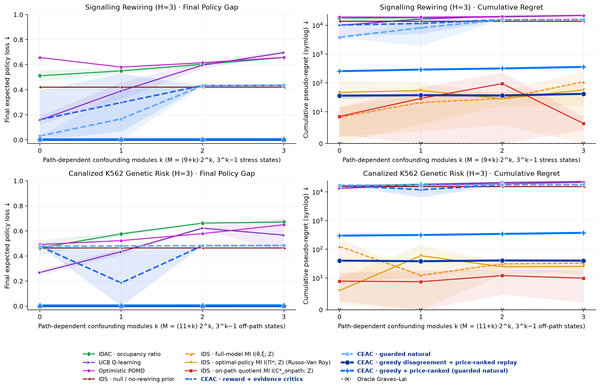
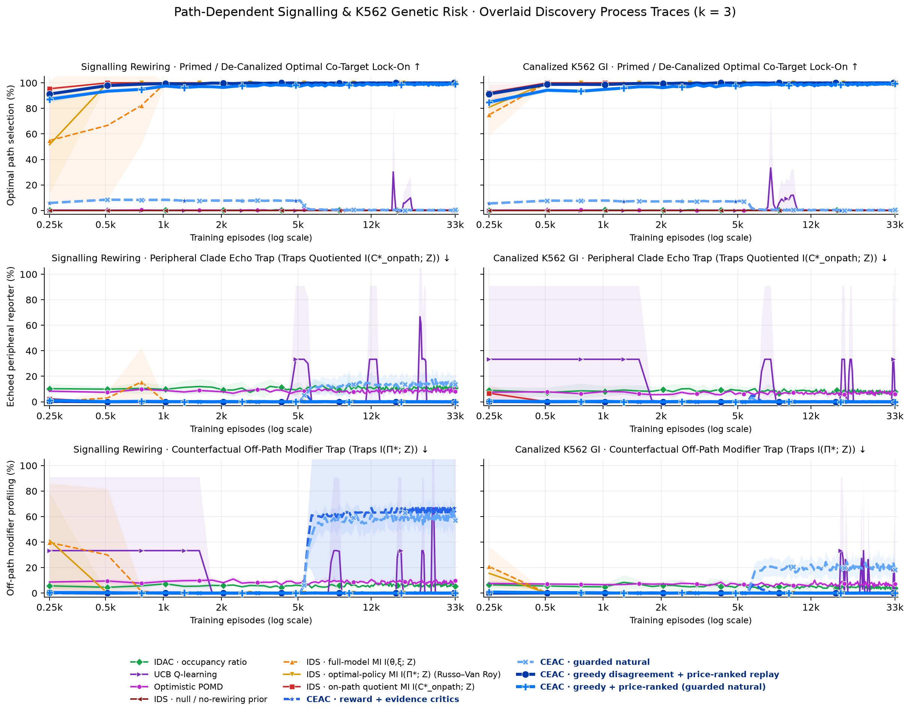

# Path-Dependent Signalling Rewiring & Canalized K562 Genetic Risk (`ceac_pathdep`)

Verified **288** held-out sweep cells (`seeds = 0, 1, 2`, `32,768` episodes / `98,304` physical steps per cell) plus **56** easy-case calibration cells (`k = 0`, `seeds 1001, 1002`, `Tasks 0 & 1`).

## Why CEAC Separates from Both Optimal-Policy MI `I(Π*; Z)` and On-Path Quotient MI `I(C*_onpath; Z)`

- **`ids_action_tree` (`I(Π*; Z)`, Russo–Van Roy MDP optimal-policy MI)**: Off-path stress/non-hub states carry local rescue rules governed by latent modifiers `ξ ∈ {0, 1}^k`, splitting `Π*(θ, ξ)` by `2^k` and trapping policy-tree IDS into profiling non-causal modifier assays (`0%` on-path return impact).
- **`ids_action_onpath` (`I(C*_onpath; Z)`, quotiented on-path class MI)**: Even after manually gifting IDS CEAC's on-path return quotient, scalar mutual information rewards cheap peripheral clade/eQTL reporters (`0.49998` return) that reduce tail entropy on peripheral candidates while providing **zero KL** between `Null` and the realized responder.
- **`ceac_ranked` & `ceac`**: Track vector-valued pairwise log-likelihood ratios across undefeated on-path alternatives and propagate dual evidence prices `β` across the `-0.015` Step-1 priming / `PPP2R1A` hub-decanalization gate via `Q_I(s, a; β)`.

## Architecture

## Dose Response Across Path-Dependent Complexity (`k = 0 -> 3`)

## Overlaid Performance & Discovery Time Traces (`k = 3`)

## Held-Out Sweep Summary (`Task 1`, `k = 0 -> 3`)

| Benchmark | Algorithm | Bank (k=3) | Final Gap (k=0 → k=3) | Regret (k=0 → k=3) | Echo% (k=3) | OffPath-Mod% (k=3) |
|---|---|---:|---:|---:|---:|---:|
| Path-Dependent Signalling Rewiring (EGFR/MEK Priming, H = 3) | IDAC · occupancy ratio | — | 0.5118 → 0.6572 | 17,496.6 → 21,563.8 | 10.69% | 6.09% |
| Path-Dependent Signalling Rewiring (EGFR/MEK Priming, H = 3) | UCB Q-learning | — | 0.1575 → 0.6963 | 9,863.7 → 22,063.7 | 5.33% | 6.13% |
| Path-Dependent Signalling Rewiring (EGFR/MEK Priming, H = 3) | Optimistic POMD | — | 0.6576 → 0.6584 | 19,308.1 → 21,575.7 | 8.51% | 8.66% |
| Path-Dependent Signalling Rewiring (EGFR/MEK Priming, H = 3) | IDS · null / no-rewiring prior | — | 0.4200 → 0.4200 | 13,762.6 → 13,762.6 | 0.00% | 0.00% |
| Path-Dependent Signalling Rewiring (EGFR/MEK Priming, H = 3) | IDS · full-model MI I(θ,ξ; Z) | — | 0.0000 → 0.0000 | 8.2 → 107.8 | 0.14% | 0.56% |
| Path-Dependent Signalling Rewiring (EGFR/MEK Priming, H = 3) | IDS · optimal-policy MI I(Π*; Z) (Russo–Van Roy) | — | 0.0000 → 0.0000 | 46.6 → 57.0 | 0.00% | 0.32% |
| Path-Dependent Signalling Rewiring (EGFR/MEK Priming, H = 3) | IDS · on-path quotient MI I(C*_onpath; Z) | — | 0.0000 → 0.0000 | 8.5 → 6.3 | 0.02% | 0.00% |
| Path-Dependent Signalling Rewiring (EGFR/MEK Priming, H = 3) | CEAC · reward + evidence critics | 13.0 | 0.1613 → 0.4350 | 10,162.3 → 15,683.0 | 0.09% | 53.50% |
| Path-Dependent Signalling Rewiring (EGFR/MEK Priming, H = 3) | CEAC · guarded natural | 13.0 | 0.0314 → 0.4361 | 3,818.3 → 15,733.8 | 11.49% | 48.91% |
| Path-Dependent Signalling Rewiring (EGFR/MEK Priming, H = 3) | CEAC · greedy disagreement + price-ranked replay | 2.0 | 0.0001 → 0.0001 | 35.7 → 41.3 | 0.01% | 0.01% |
| Path-Dependent Signalling Rewiring (EGFR/MEK Priming, H = 3) | CEAC · greedy + price-ranked (guarded natural) | 2.0 | 0.0045 → 0.0061 | 253.4 → 356.1 | 0.07% | 0.06% |
| Path-Dependent Signalling Rewiring (EGFR/MEK Priming, H = 3) | Oracle Graves–Lai | — | 0.0000 → 0.0000 | 0.0 → 0.0 | 0.00% | 0.00% |
| Canalized Genetic Risk Screen (K562 PPP2R1A Hub, H = 3) | IDAC · occupancy ratio | — | 0.4648 → 0.6714 | 16,061.5 → 21,656.6 | 8.05% | 4.83% |
| Canalized Genetic Risk Screen (K562 PPP2R1A Hub, H = 3) | UCB Q-learning | — | 0.2681 → 0.5667 | 13,136.3 → 22,982.6 | 5.25% | 2.37% |
| Canalized Genetic Risk Screen (K562 PPP2R1A Hub, H = 3) | Optimistic POMD | — | 0.4917 → 0.6491 | 16,113.3 → 21,271.3 | 6.82% | 6.88% |
| Canalized Genetic Risk Screen (K562 PPP2R1A Hub, H = 3) | IDS · null / no-rewiring prior | — | 0.4635 → 0.4635 | 15,188.5 → 15,188.5 | 0.00% | 0.00% |
| Canalized Genetic Risk Screen (K562 PPP2R1A Hub, H = 3) | IDS · full-model MI I(θ,ξ; Z) | — | 0.0000 → 0.0000 | 125.3 → 32.8 | 0.00% | 0.16% |
| Canalized Genetic Risk Screen (K562 PPP2R1A Hub, H = 3) | IDS · optimal-policy MI I(Π*; Z) (Russo–Van Roy) | — | 0.0000 → 0.0000 | 6.1 → 25.2 | 0.00% | 0.12% |
| Canalized Genetic Risk Screen (K562 PPP2R1A Hub, H = 3) | IDS · on-path quotient MI I(C*_onpath; Z) | — | 0.0000 → 0.0000 | 9.0 → 9.9 | 0.05% | 0.00% |
| Canalized Genetic Risk Screen (K562 PPP2R1A Hub, H = 3) | CEAC · reward + evidence critics | 14.0 | 0.4780 → 0.4837 | 16,989.8 → 17,741.5 | 0.10% | 0.26% |
| Canalized Genetic Risk Screen (K562 PPP2R1A Hub, H = 3) | CEAC · guarded natural | 14.0 | 0.4782 → 0.4845 | 16,989.7 → 17,742.3 | 0.16% | 16.58% |
| Canalized Genetic Risk Screen (K562 PPP2R1A Hub, H = 3) | CEAC · greedy disagreement + price-ranked replay | 2.0 | 0.0001 → 0.0001 | 40.1 → 40.1 | 0.00% | 0.01% |
| Canalized Genetic Risk Screen (K562 PPP2R1A Hub, H = 3) | CEAC · greedy + price-ranked (guarded natural) | 2.0 | 0.0053 → 0.0065 | 298.9 → 373.8 | 0.06% | 0.07% |
| Canalized Genetic Risk Screen (K562 PPP2R1A Hub, H = 3) | Oracle Graves–Lai | — | 0.0000 → 0.0000 | 0.0 → 0.0 | 0.00% | 0.00% |

## Paired Regret Saved by `ceac_ranked` at `k = 3` (`Task 1`)

| Benchmark | Comparator | Regret Saved vs `ceac_ranked` (mean ± SD) | `ceac_ranked` Lower on All Seeds |
|---|---|---:|---|
| Path-Dependent Signalling Rewiring (EGFR/MEK Priming, H = 3) | IDAC · occupancy ratio | +21,522.4 ± 192.3 | True |
| Path-Dependent Signalling Rewiring (EGFR/MEK Priming, H = 3) | UCB Q-learning | +22,022.4 ± 166.1 | True |
| Path-Dependent Signalling Rewiring (EGFR/MEK Priming, H = 3) | Optimistic POMD | +21,534.3 ± 1.6 | True |
| Path-Dependent Signalling Rewiring (EGFR/MEK Priming, H = 3) | IDS · null / no-rewiring prior | +13,721.2 ± 1.6 | True |
| Path-Dependent Signalling Rewiring (EGFR/MEK Priming, H = 3) | IDS · full-model MI I(θ,ξ; Z) | +66.5 ± 149.1 | False |
| Path-Dependent Signalling Rewiring (EGFR/MEK Priming, H = 3) | IDS · optimal-policy MI I(Π*; Z) (Russo–Van Roy) | +15.7 ± 40.3 | False |
| Path-Dependent Signalling Rewiring (EGFR/MEK Priming, H = 3) | IDS · on-path quotient MI I(C*_onpath; Z) | -35.0 ± 2.9 | False |
| Path-Dependent Signalling Rewiring (EGFR/MEK Priming, H = 3) | CEAC · reward + evidence critics | +15,641.6 ± 10.4 | True |
| Path-Dependent Signalling Rewiring (EGFR/MEK Priming, H = 3) | CEAC · guarded natural | +15,692.5 ± 6.3 | True |
| Path-Dependent Signalling Rewiring (EGFR/MEK Priming, H = 3) | CEAC · greedy + price-ranked (guarded natural) | +314.7 ± 8.5 | True |
| Path-Dependent Signalling Rewiring (EGFR/MEK Priming, H = 3) | Oracle Graves–Lai | -41.3 ± 1.6 | False |
| Canalized Genetic Risk Screen (K562 PPP2R1A Hub, H = 3) | IDAC · occupancy ratio | +21,616.5 ± 575.7 | True |
| Canalized Genetic Risk Screen (K562 PPP2R1A Hub, H = 3) | UCB Q-learning | +22,942.4 ± 82.9 | True |
| Canalized Genetic Risk Screen (K562 PPP2R1A Hub, H = 3) | Optimistic POMD | +21,231.2 ± 5.2 | True |
| Canalized Genetic Risk Screen (K562 PPP2R1A Hub, H = 3) | IDS · null / no-rewiring prior | +15,148.4 ± 5.2 | True |
| Canalized Genetic Risk Screen (K562 PPP2R1A Hub, H = 3) | IDS · full-model MI I(θ,ξ; Z) | -7.3 ± 16.3 | False |
| Canalized Genetic Risk Screen (K562 PPP2R1A Hub, H = 3) | IDS · optimal-policy MI I(Π*; Z) (Russo–Van Roy) | -15.0 ± 11.4 | False |
| Canalized Genetic Risk Screen (K562 PPP2R1A Hub, H = 3) | IDS · on-path quotient MI I(C*_onpath; Z) | -30.2 ± 9.1 | False |
| Canalized Genetic Risk Screen (K562 PPP2R1A Hub, H = 3) | CEAC · reward + evidence critics | +17,701.4 ± 13.1 | True |
| Canalized Genetic Risk Screen (K562 PPP2R1A Hub, H = 3) | CEAC · guarded natural | +17,702.2 ± 3.8 | True |
| Canalized Genetic Risk Screen (K562 PPP2R1A Hub, H = 3) | CEAC · greedy + price-ranked (guarded natural) | +333.6 ± 6.8 | True |
| Canalized Genetic Risk Screen (K562 PPP2R1A Hub, H = 3) | Oracle Graves–Lai | -40.1 ± 5.2 | False |
